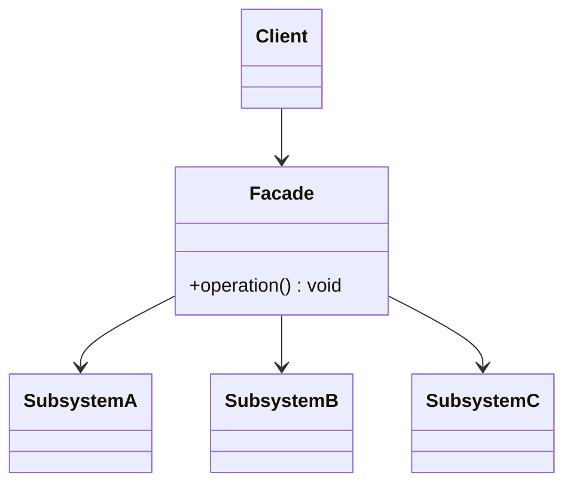

# Facade Pattern

> Provides a unified interface to a set of interfaces in a subsystem, defining a higher-level interface that makes the subsystem easier to use.

## Intent

Facade is a **structural** design pattern. It encapsulates a complex subsystem behind a facade class and offers clients a simple high-level interface, simplifying interaction and reducing coupling.

## Problem

A system can become very complex, with many subsystems and interactions whose dependencies and calls grow tangled, making the system hard to understand, extend and maintain.

## Solution

Facade introduces a facade class that encapsulates the complex subsystem interfaces; clients interact only with the facade, which forwards requests to the appropriate subsystems. Facade adds no new functionality — it only provides a simpler interface.

| Role | Description |
|------|-------------|
| Facade | Encapsulates the subsystems and offers clients a unified high-level interface |
| Subsystem | A set of classes that do the actual work, invoked by the facade |

## Structure

- **Facade**: aggregates the subsystems and exposes a simplified interface.
- **Subsystem**: the concrete functionality classes clients do not depend on directly.
- **Client**: depends only on the facade.

## Effects

**Pros**

- **Simplified interface**: clients need not understand subsystem complexity.
- **Lower coupling**: clients are decoupled from subsystems.
- **Better maintainability**: internal subsystem changes do not affect clients.
- **Loose coupling**: modules can be developed and tested independently.

**Cons**

- **Potential god object**: a poorly designed facade may over-concentrate responsibilities.

**When to use**

- When you need to offer a simple interface over a complex subsystem and simplify client usage.

## Cases in this project

- [One-Click Boot](computerstart/README.md) — encapsulates the hardware subsystems involved in booting.
- [Home Theater](hometheater/README.md) — encapsulates the stereo, projector and lights.