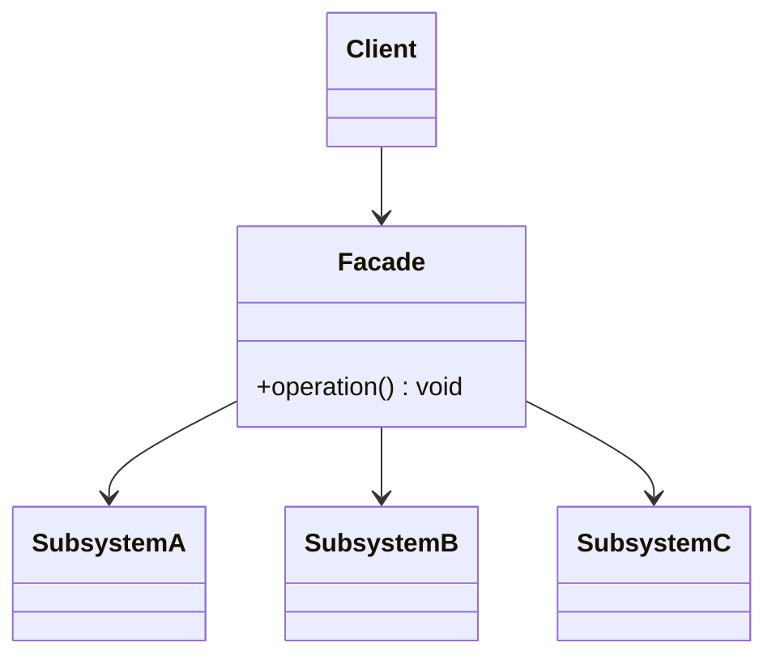

# 外观模式（Facade）

> 为子系统中的一组接口提供一个一致的界面，外观模式定义了一个高层接口，这个接口使得这一子系统更加容易使用。

## 意图

外观模式（Facade）是一种**结构型**设计模式。它用一个外观类封装复杂的子系统，为客户端提供一个简单的高层接口，从而简化交互、降低耦合。

## 问题

系统可能变得非常复杂，包含多个子系统和各种交互，依赖关系与调用变得混乱，导致系统难以理解、扩展和维护。

## 解决方案

外观模式引入外观类，把复杂子系统的接口封装起来，客户端只与外观交互，由外观把请求转发给适当的子系统。外观并不添加新功能，只是提供一个更简洁的接口。

| 角色 | 说明 |
|------|------|
| 外观 | 封装子系统，为客户端提供统一的高层接口 |
| 子系统 | 一组功能类，负责具体工作，由外观调用 |

## 结构

- **外观（Facade）**：聚合各子系统，对外暴露简化接口。
- **子系统（Subsystem）**：具体功能类，客户端不直接依赖。
- **客户端（Client）**：只依赖外观类。

## 效果

**优点**

- **简化接口**：客户端无需了解子系统复杂性。
- **降低耦合**：客户端与子系统解耦，系统变化不影响客户端。
- **提高可维护性**：子系统内部修改不影响客户端。
- **支持松散耦合**：便于模块独立开发与测试。

**缺点**

- **可能成为「上帝对象」**：外观若设计不当，可能过度集中职责。

**适用场景**

- 需要为复杂子系统提供简单接口、简化客户端使用的场景。

## 项目中的案例

- [电脑一键开机](computerstart/README_zh.md) —— 用外观封装开机涉及的多个硬件子系统。
- [家庭影院](hometheater/README_zh.md) —— 用外观封装音响、投影仪、灯光等子系统。