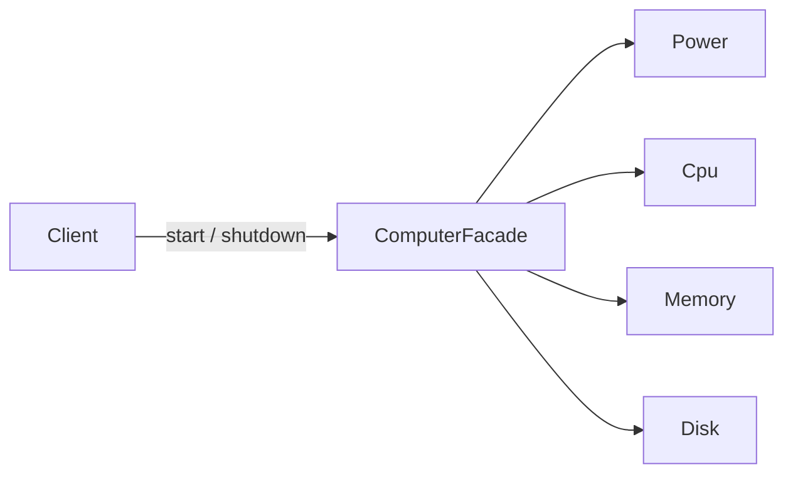
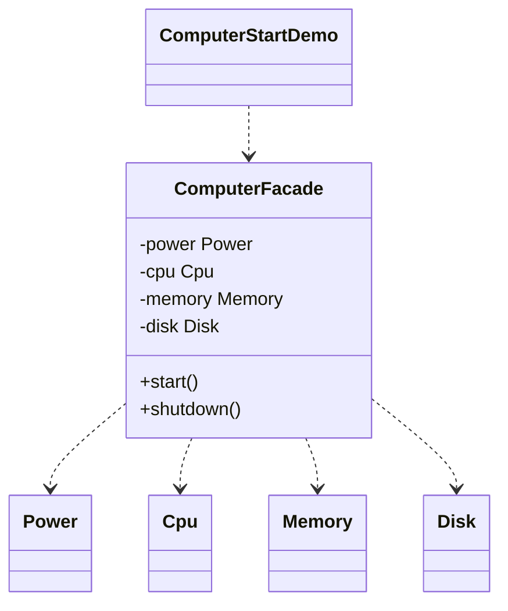

# One-Click Boot — Facade

> Hides the power/CPU/memory/disk startup sequence behind one `start()` and
> one `shutdown()` call.

## Big Picture

## Scenario

Turning a computer on or off involves several subsystems in a fixed order.
Clients should not call each subsystem directly; they just want to boot or
shut down. A facade exposes two simple operations and coordinates the
subsystems internally.

## Design Pattern

**Facade** — provides a unified interface to a set of interfaces in a
subsystem, making it easier to use.

Why it fits:

- `Power`, `Cpu`, `Memory`, `Disk` are the messy subsystem classes.
- `ComputerFacade` exposes only `start()` and `shutdown()`.
- Clients depend on the facade instead of four subsystems.

## Structure

| Role | Participants |
|------|--------------|
| Facade | `ComputerFacade` |
| Subsystems | `Power`, `Cpu`, `Memory`, `Disk` |
| Client / demo | `ComputerStartDemo` |

## Design Rationale

- The boot/shutdown scenario is the classic facade example, clearly distinct
  from the existing "Home Theater" pair.
- One entry point hides the fixed subsystem ordering, showing the pattern's
  simplification benefit.
- One file per type, following the Java convention, keeps each role readable.