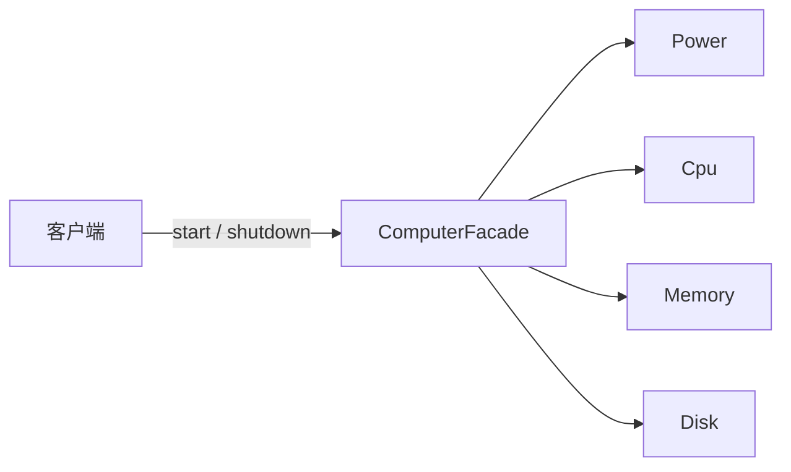
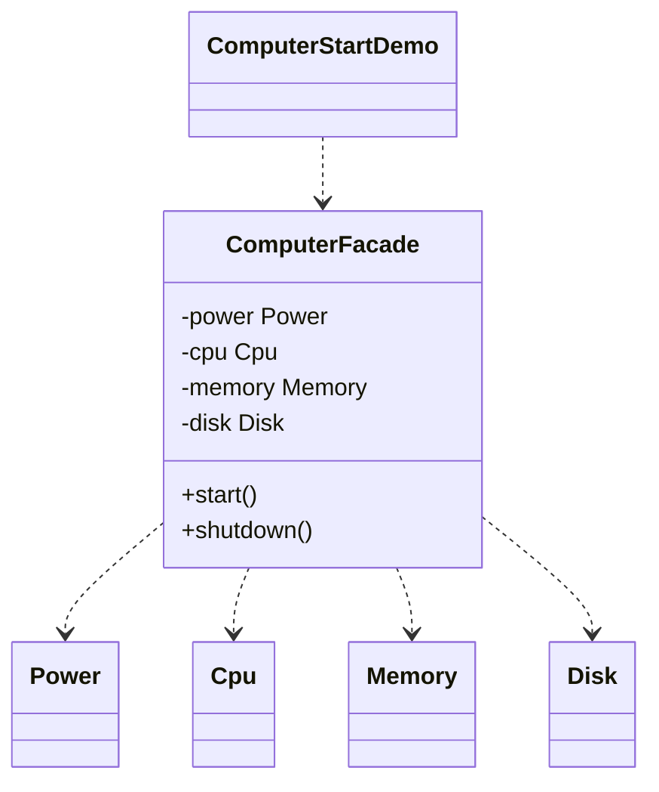

# 电脑一键开机 — 外观

> 把电源/CPU/内存/硬盘的开机顺序隐藏在 `start()` 与 `shutdown()` 两个调用之后。

## 整体概览

## 场景描述

开机或关机涉及多个子系统按固定顺序协作。客户端不该逐一调用每个子系统，它只想
开机或关机。外观类暴露两个简单操作，在内部协调各子系统。

## 设计模式

**外观** —— 为子系统中的一组接口提供统一入口，使其更易使用。

为什么匹配：

- `Power`、`Cpu`、`Memory`、`Disk` 是繁杂的子系统类。
- `ComputerFacade` 只暴露 `start()` 与 `shutdown()`。
- 客户端只依赖外观，而非四个子系统。

## 结构

| 角色 | 参与者 |
|------|--------|
| 外观 | `ComputerFacade` |
| 子系统 | `Power`、`Cpu`、`Memory`、`Disk` |
| 客户端 / 演示 | `ComputerStartDemo` |

## 设计理念

- 开机/关机场景是外观模式的经典示例，与已有的"家庭影院"明显区分。
- 单一入口隐藏固定的子系统顺序，直观体现该模式的简化收益。
- 遵循 Java 惯例一个类型一个文件，让每个角色都清晰可读。