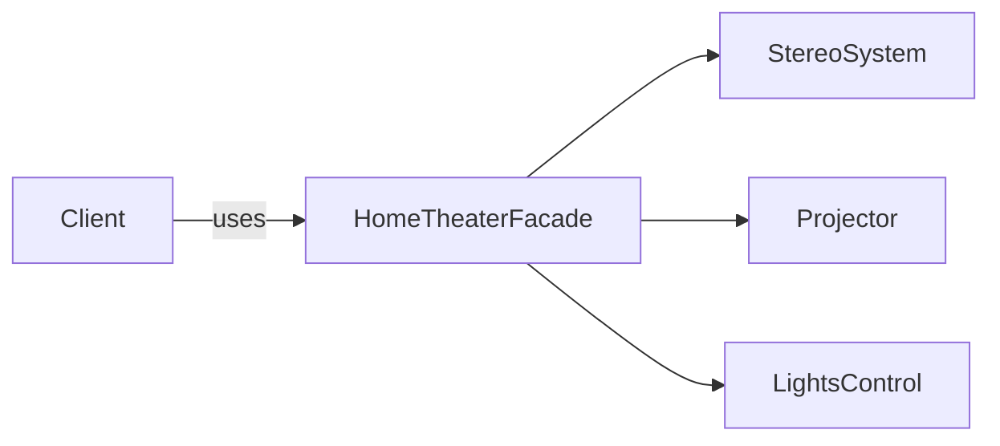
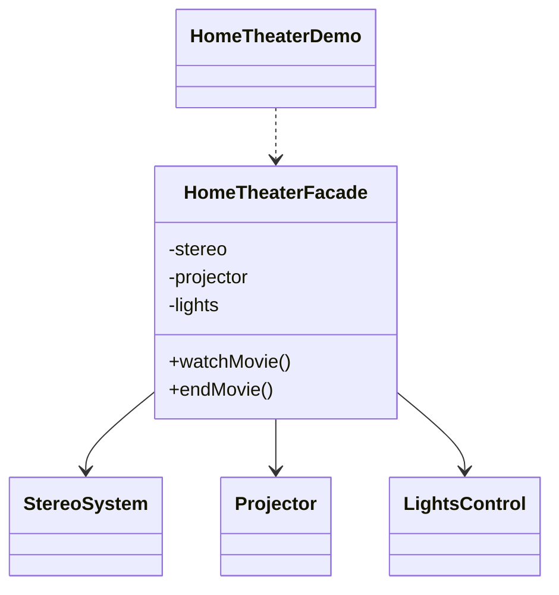

# Home Theater — Facade

> Provides one simple interface (`watchMovie` / `endMovie`) over several home
> theater subsystems, hiding the messy startup and shutdown sequences.

## Big Picture

## Scenario

Watching a movie requires turning off the lights, turning on the projector and
turning on the stereo — and reversing all of that afterward. Instead of exposing
these steps to every client, a facade bundles them into two high-level methods.

## Design Pattern

**Facade** — provides a unified interface to a set of interfaces in a subsystem,
making the subsystem easier to use.

Why it fits:

- `StereoSystem`, `Projector`, `LightsControl` are the **subsystem** classes.
- `HomeTheaterFacade` is the **facade** that orchestrates them.
- The client calls only the facade, never the individual subsystems.

## Structure

| Role | Participants |
|------|--------------|
| Facade | `HomeTheaterFacade` |
| Subsystems | `StereoSystem`, `Projector`, `LightsControl` |
| Client / demo | `HomeTheaterDemo` |

## Design Rationale

- The facade hides ordering and coupling among subsystems, so the client only
  expresses intent ("watch" vs "end").
- Each subsystem keeps a narrow, consistent interface (`turnOn`/`turnOff`), making
  the facade's orchestration readable.
- One file per type separates the facade from its subsystems.