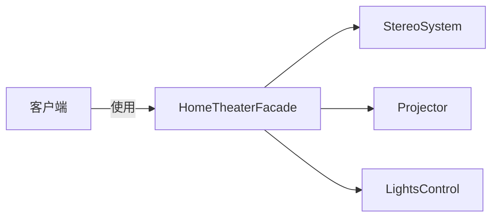
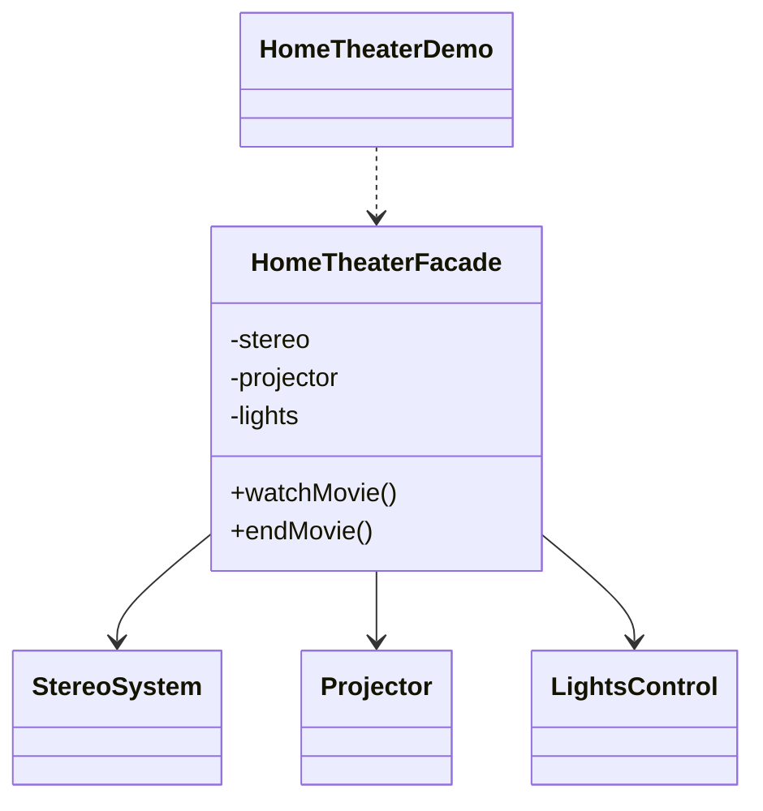

# 家庭影院 — 外观

> 在多个影院子系统之上提供一个简单接口（`watchMovie` / `endMovie`），
> 隐藏繁琐的开机与关机流程。

## 整体概览

## 场景描述

看一场电影需要关灯、开投影仪、开音响——之后还要全部反向操作一遍。与其把这些
步骤暴露给每个客户端，不如用外观把它们打包成两个高层方法。

## 设计模式

**外观** —— 为子系统中的一组接口提供统一接口，使子系统更易使用。

为什么匹配：

- `StereoSystem`、`Projector`、`LightsControl` 是**子系统**类。
- `HomeTheaterFacade` 是编排它们的**外观**。
- 客户端只调用外观，从不直接接触各子系统。

## 结构

| 角色 | 参与者 |
|------|--------|
| 外观 | `HomeTheaterFacade` |
| 子系统 | `StereoSystem`、`Projector`、`LightsControl` |
| 客户端 / 演示 | `HomeTheaterDemo` |

## 设计理念

- 外观隐藏了子系统之间的顺序与耦合，客户端只需表达意图（「开始看」还是「结束」）。
- 每个子系统保持窄而一致的接口（`turnOn`/`turnOff`），让外观的编排清晰可读。
- 一个类型一个文件，外观与各子系统分开。