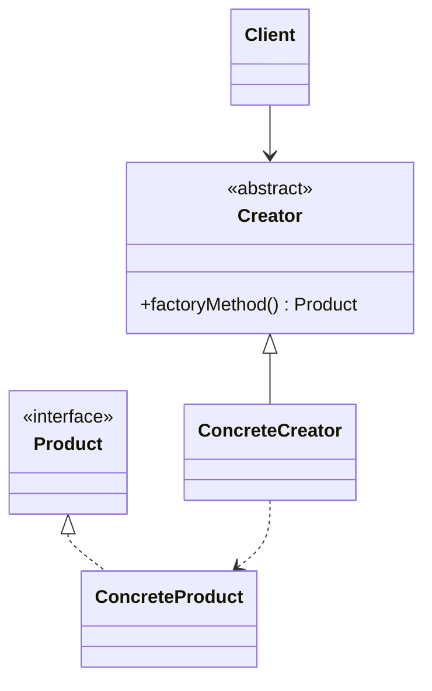

# Factory Method Pattern

> Defines an interface for creating an object, but lets subclasses decide which class to instantiate. Factory Method lets a class defer instantiation to subclasses.

## Intent

Factory Method is a **creational** design pattern. It encapsulates object creation in an abstract factory method, letting subclasses decide which concrete product to create. Clients program only against the abstract factory, never knowing the concrete product class and never calling `new` on it directly.

## Problem

Software design often requires creating objects of different types. Instantiating them directly couples the code to concrete classes, making it hard to maintain and extend; when the creation approach changes, many places in the code must be modified. Factory Method exists to solve exactly this problem.

## Solution

Factory Method provides an interface for creating an object but defers the actual creation to subclasses. An abstract factory class declares an abstract factory method, and concrete factory subclasses implement it to create the corresponding product. Clients only invoke the factory method through the abstract factory.

| Role | Description |
|------|-------------|
| Product | Declares the interface of the product objects |
| Concrete product | Implements the product interface and is the actual object created |
| Creator (abstract factory) | Declares the factory method returning a product |
| Concrete creator (concrete factory) | Overrides the factory method to return a concrete product |

## Structure

- **Product**: the common interface of all products.
- **ConcreteProduct**: a concrete implementation of the product.
- **Creator**: declares the factory method returning an abstract product.
- **ConcreteCreator**: overrides the factory method to return a concrete product.
- **Client**: depends only on the abstract factory and product interface, never on concrete classes.

## Effects

**Pros**

- **Loose coupling**: clients are decoupled from concrete product creation.
- **Extensibility**: new product types are added via new factory and product subclasses.
- **Encapsulation**: creation is centralized in factory classes, keeping clients simple.

**Cons**

- **More classes**: requires building factory and product class hierarchies.

**When to use**

- When you need to create objects of different types without coupling clients to concrete classes.
- When the creation approach may change over time.

## Cases in this project

- [Logger Factory](loggerfactory/README.md) — creates different logger types on demand via a factory method.
- [Shape Factory](shapefactory/README.md) — creates circles, rectangles and other shapes via a factory method.