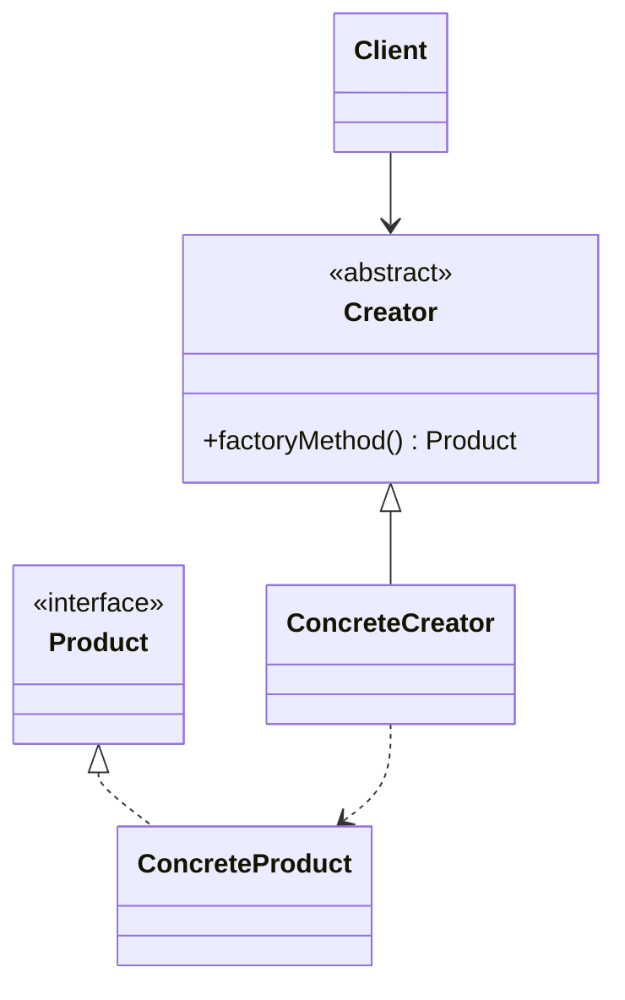

# 工厂方法模式（Factory Method）

> 定义一个用于创建对象的接口，让子类决定实例化哪一个类。工厂方法使一个类的实例化延迟到其子类。

## 意图

工厂方法模式（Factory Method）是一种**创建型**设计模式。它把对象的创建封装在一个抽象工厂方法中，让子类决定具体创建哪种产品。客户端只面向抽象工厂编程，无需知道具体产品的类，也不直接 `new` 具体对象。

## 问题

在软件设计中经常需要创建不同类型的对象。如果直接在代码里实例化对象，会让代码与具体类紧密耦合，难以维护和扩展；一旦对象的创建方式发生变化，就需要在代码各处大量修改。工厂方法模式正是为了解决这一问题。

## 解决方案

工厂方法模式提供一个创建对象的接口，但将具体对象的创建延迟到子类中。抽象工厂类声明一个抽象的工厂方法，具体工厂子类实现该方法以创建对应的产品。客户端只需通过抽象工厂调用工厂方法，无需关心创建细节。

| 角色 | 说明 |
|------|------|
| 产品 | 定义产品对象的接口 |
| 具体产品 | 实现产品接口，是工厂方法实际创建的对象 |
| 抽象工厂 | 声明工厂方法，返回产品对象 |
| 具体工厂 | 重写工厂方法，返回具体产品实例 |

## 结构

- **产品（Product）**：所有产品共有的接口。
- **具体产品（ConcreteProduct）**：产品的具体实现。
- **抽象工厂（Creator）**：声明工厂方法，返回抽象产品。
- **具体工厂（ConcreteCreator）**：重写工厂方法，返回具体产品。
- **客户端（Client）**：只依赖抽象工厂与产品接口，不关心具体类。

## 效果

**优点**

- **松耦合**：客户端与具体产品的创建解耦，系统更具弹性与可维护性。
- **扩展性**：新增具体工厂与产品子类即可支持新对象类型。
- **封装性**：对象创建集中在工厂类中，客户端代码更简洁。

**缺点**

- **类数量增加**：需要定义多个工厂类与产品类的层次结构。

**适用场景**

- 需要创建不同类型对象、且不希望客户端与具体类耦合的场景。
- 对象的创建方式可能随需求变化的场景。

## 项目中的案例

- [日志工厂](loggerfactory/README_zh.md) —— 用工厂方法按需创建不同类型的日志器。
- [图形工厂](shapefactory/README_zh.md) —— 用工厂方法创建圆形、矩形等图形对象。