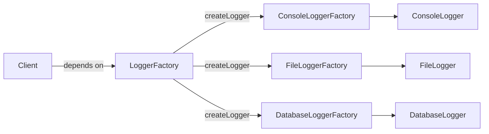
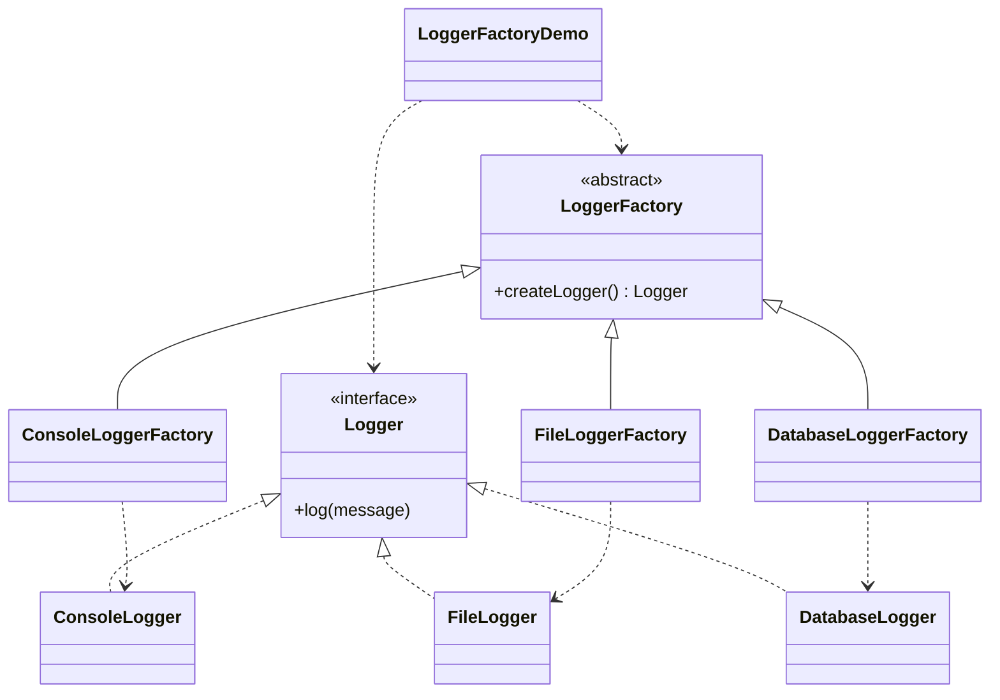

# Logger Factory — Factory Method

> Chooses a concrete logger (console / file / database) through a factory
> method, keeping the client decoupled from concrete logger classes.

## Big Picture

## Scenario

An application wants to write logs to different targets — console, file or
database — depending on configuration. The client should not know which
concrete logger it is using. Each concrete factory overrides `createLogger()`
and returns the right product; the client only ever calls the abstract
factory method.

## Design Pattern

**Factory Method** — defines an interface for creating an object, but lets
subclasses decide which class to instantiate.

Why it fits:

- There is **one abstract product** (`Logger`) and **three concrete products**.
- Each concrete `LoggerFactory` overrides the single factory method
  `createLogger()` to decide the concrete class.
- The client depends only on `LoggerFactory` and `Logger`, so adding a new
  target only requires a new factory subclass.

## Structure

| Role | Participants |
|------|--------------|
| Abstract product | `Logger` |
| Concrete products | `ConsoleLogger`, `FileLogger`, `DatabaseLogger` |
| Abstract factory | `LoggerFactory` |
| Concrete factories | `ConsoleLoggerFactory`, `FileLoggerFactory`, `DatabaseLoggerFactory` |
| Client / demo | `LoggerFactoryDemo` |

## Design Rationale

- This is the classic "log to different targets" scenario, clearly distinct
  from the existing "Shape Factory" example.
- The product and factory stay on the **same conceptual level** (logging
  targets), keeping the hierarchy easy to grasp.
- One file per type, following the Java convention, keeps each role readable.