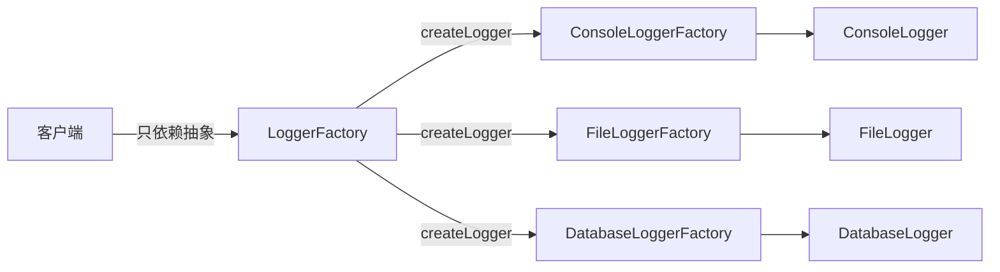
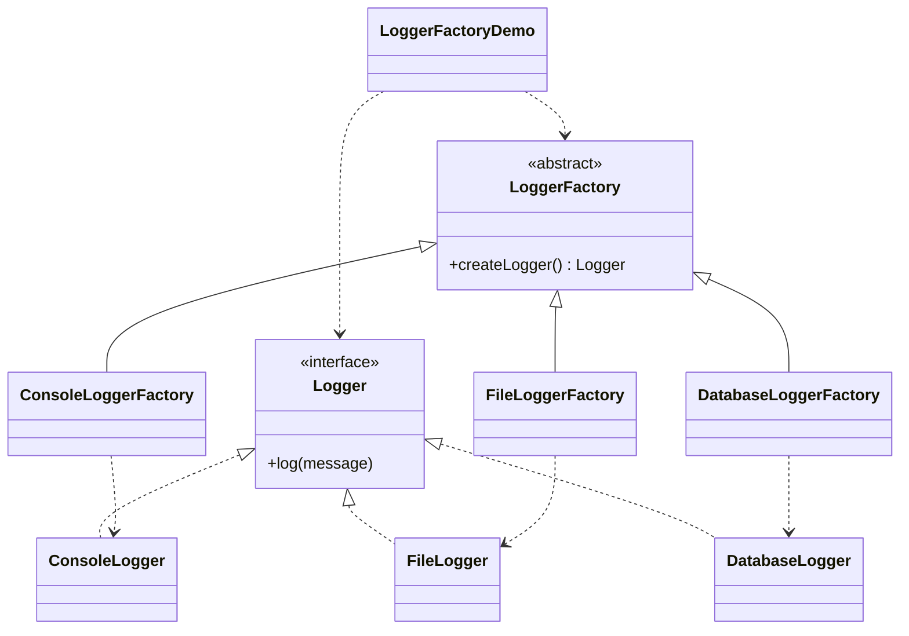

# 日志工厂 — 工厂方法

> 通过工厂方法选择具体的日志记录器（控制台 / 文件 / 数据库），
> 让客户端与具体日志类解耦。

## 整体概览

## 场景描述

一个应用需要按配置把日志写到不同目标——控制台、文件或数据库。客户端不应关心
自己正在使用哪个具体日志类。每个具体工厂重写 `createLogger()` 返回对应产品，
客户端只调用抽象工厂方法。

## 设计模式

**工厂方法** —— 定义创建对象的接口，但由子类决定实例化哪个类。

为什么匹配：

- 存在 **1 个抽象产品**（`Logger`）与 **3 个具体产品**。
- 每个具体 `LoggerFactory` 重写唯一的工厂方法 `createLogger()` 来指定具体类。
- 客户端只依赖 `LoggerFactory` 与 `Logger`，新增目标只需新增一个工厂子类。

## 结构

| 角色 | 参与者 |
|------|--------|
| 抽象产品 | `Logger` |
| 具体产品 | `ConsoleLogger`、`FileLogger`、`DatabaseLogger` |
| 抽象工厂 | `LoggerFactory` |
| 具体工厂 | `ConsoleLoggerFactory`、`FileLoggerFactory`、`DatabaseLoggerFactory` |
| 客户端 / 演示 | `LoggerFactoryDemo` |

## 设计理念

- 这是"日志写到不同目标"的经典场景，与已有的"形状工厂"示例明显区分。
- 产品与工厂都处于**同一概念层级**（日志目标），层次清晰易理解。
- 遵循 Java 惯例一个类型一个文件，让每个角色都清晰可读。