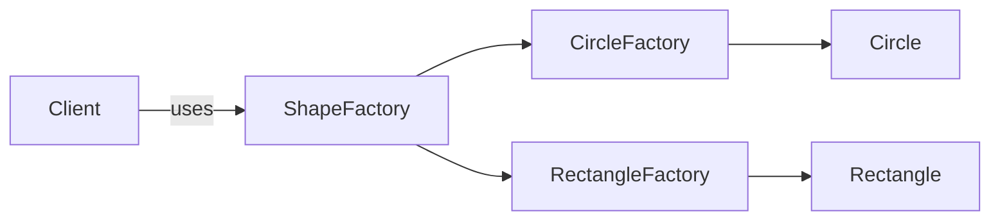
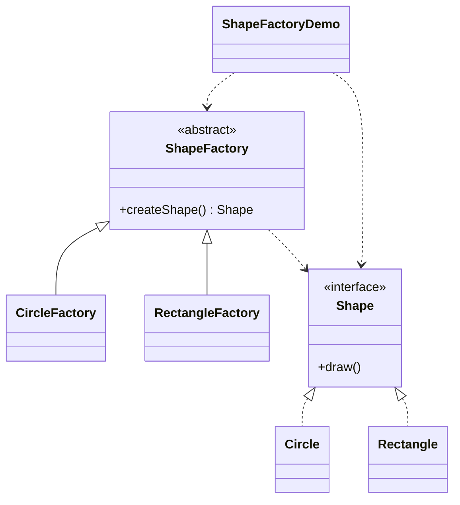

# Shape Factory — Factory Method

> Defines a `ShapeFactory` with a `createShape()` factory method, letting each
> concrete factory decide which shape to instantiate.

## Big Picture

## Scenario

A drawing app needs to create shapes, but the exact shape type should be decided
by a factory rather than by the client. Each shape type has its own factory, and
the client only depends on the abstract `ShapeFactory` and `Shape`.

## Design Pattern

**Factory Method** — defines an interface for creating an object, but lets
subclasses decide which class to instantiate.

Why it fits:

- `Shape` is the **product**; `Circle` and `Rectangle` are concrete products.
- `ShapeFactory` is the **creator** with the factory method `createShape()`.
- `CircleFactory`/`RectangleFactory` are **concrete creators** that override the
  factory method to return a specific shape.

## Structure

| Role | Participants |
|------|--------------|
| Product | `Shape` |
| Concrete products | `Circle`, `Rectangle` |
| Creator | `ShapeFactory` |
| Concrete creators | `CircleFactory`, `RectangleFactory` |
| Client / demo | `ShapeFactoryDemo` |

## Design Rationale

- The client never calls `new Circle()`; it only uses `createShape()`, so adding
  a new shape means adding a product and a factory, not changing the client.
- Keeping the creator abstract (not an interface) matches the classic factory
  method form where a base class declares the factory method.
- One file per type separates product, creator and concrete creators.