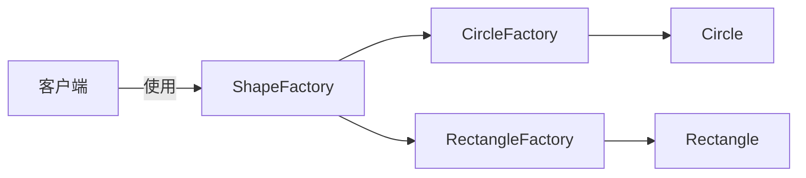
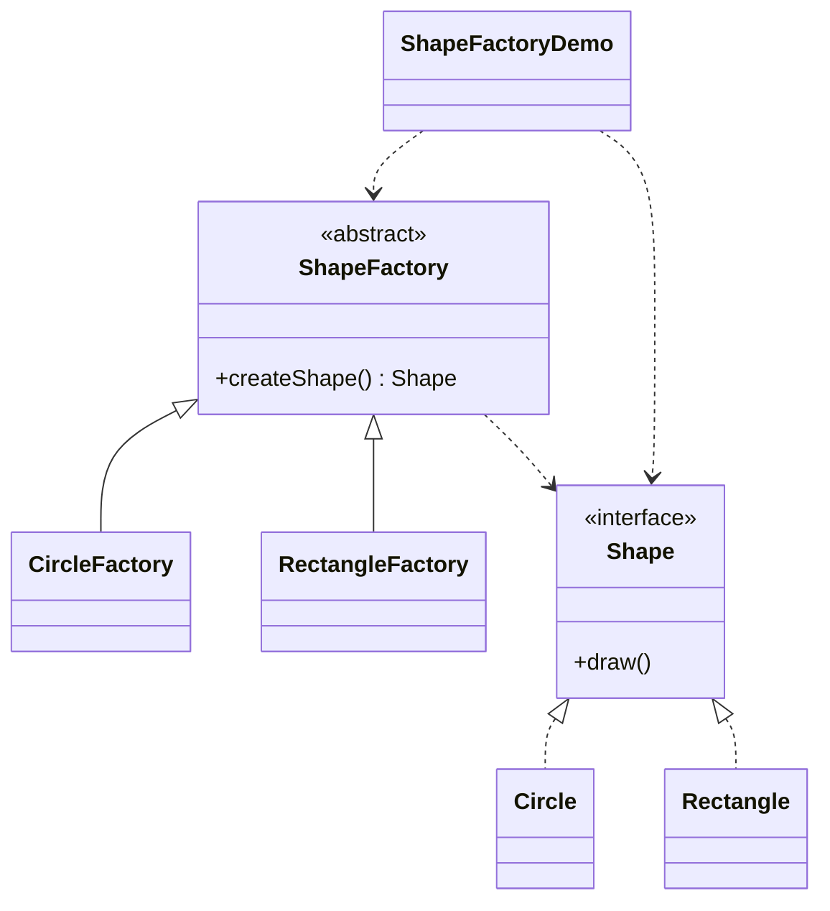

# 图形工厂 — 工厂方法

> 定义带 `createShape()` 工厂方法的 `ShapeFactory`，让每个具体工厂决定实例化哪种图形。

## 整体概览

## 场景描述

绘图应用需要创建图形，但具体图形类型应由工厂决定而非由客户端决定。每种图形
类型都有自己的工厂，客户端只依赖抽象的 `ShapeFactory` 和 `Shape`。

## 设计模式

**工厂方法** —— 定义创建对象的接口，但由子类决定实例化哪一个类。

为什么匹配：

- `Shape` 是**产品**；`Circle` 和 `Rectangle` 是具体产品。
- `ShapeFactory` 是带工厂方法 `createShape()` 的**创建者**。
- `CircleFactory`/`RectangleFactory` 是覆写工厂方法以返回特定图形的**具体创建者**。

## 结构

| 角色 | 参与者 |
|------|--------|
| 产品 | `Shape` |
| 具体产品 | `Circle`、`Rectangle` |
| 创建者 | `ShapeFactory` |
| 具体创建者 | `CircleFactory`、`RectangleFactory` |
| 客户端 / 演示 | `ShapeFactoryDemo` |

## 设计理念

- 客户端从不直接 `new Circle()`，只调用 `createShape()`，因此新增图形只需新增
  一个产品和一个工厂，无需改动客户端。
- 创建者保持抽象类（而非接口），符合工厂方法的经典形态：由基类声明工厂方法。
- 一个类型一个文件，产品、创建者与具体创建者各归其位。