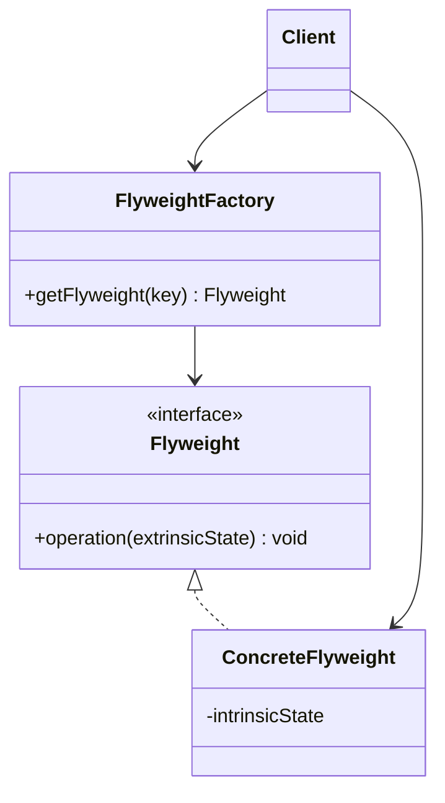

# Flyweight Pattern

> Uses sharing to support large numbers of fine-grained objects efficiently.

## Intent

Flyweight is a **structural** design pattern. It reduces memory and resource consumption by sharing objects, splitting object state into shareable intrinsic state and non-shareable extrinsic state.

## Problem

An application may need many similar objects whose properties are mostly identical. Creating them in bulk consumes a lot of memory and system resources, degrading performance.

## Solution

Flyweight shares intrinsic state while leaving extrinsic state to each object. A flyweight factory manages and reuses shared objects, returning an existing object with the same intrinsic state when available.

| Role | Description |
|------|-------------|
| Flyweight | Declares the interface that receives extrinsic state |
| Concrete flyweight | Implements the flyweight interface and stores shareable intrinsic state |
| Flyweight factory | Creates and manages shared objects, reusing them by intrinsic state |
| Client | Holds extrinsic state and requests flyweights from the factory |

## Structure

- **Flyweight**: declares the interface that receives extrinsic state.
- **ConcreteFlyweight**: stores intrinsic state and completes operations with extrinsic state.
- **FlyweightFactory**: maintains a pool and reuses instances by intrinsic state.
- **Client**: holds extrinsic state and obtains flyweights from the factory.

## Effects

**Pros**

- **Significantly less memory**: intrinsic state is stored only once.
- **Better performance**: reuses pooled objects, reducing creation overhead.

**Cons**

- **More complexity**: intrinsic/extrinsic state must be separated, and shared intrinsic state requires thread-safety considerations.
- **Bounded applicability**: only fits when intrinsic state is relatively stable while extrinsic state varies.

**When to use**

- When you need many similar objects whose intrinsic state can be shared, such as characters or pixels.

## Cases in this project

- [Gobang Pieces](gobang/README.md) — shares piece colors instead of creating an object per piece.
- [Circle Pool](circlepool/README.md) — reuses circle objects of the same color via a pool.