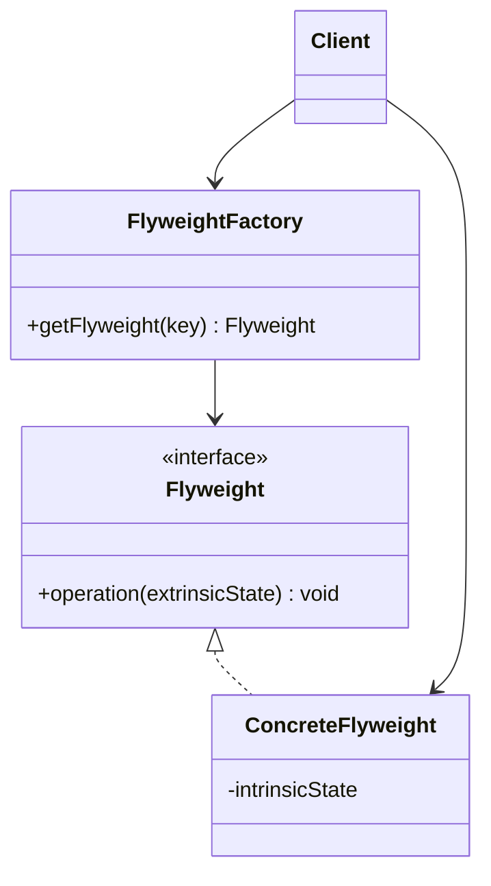

# 享元模式（Flyweight）

> 运用共享技术有效地支持大量细粒度的对象。

## 意图

享元模式（Flyweight）是一种**结构型**设计模式。它通过共享对象来减少内存与资源消耗，把对象状态区分为可共享的内部状态与不可共享的外部状态。

## 问题

应用可能需要大量相似对象，而这些对象的大部分属性是相同的。创建大量相似对象会占用大量内存与系统资源，导致性能下降。

## 解决方案

享元模式共享对象的内部状态（Intrinsic State），将外部状态（Extrinsic State）留给每个对象单独持有。享元工厂负责管理和复用共享对象，需要时优先返回已有的相同内部状态对象。

| 角色 | 说明 |
|------|------|
| 享元 | 声明接收外部状态的接口 |
| 具体享元 | 实现享元接口，保存可共享的内部状态 |
| 享元工厂 | 创建并管理共享对象，按内部状态复用已有对象 |
| 客户端 | 持有外部状态，向工厂请求享元对象 |

## 结构

- **享元（Flyweight）**：声明接收外部状态的接口。
- **具体享元（ConcreteFlyweight）**：保存内部状态，接收外部状态完成操作。
- **享元工厂（FlyweightFactory）**：维护对象池，按内部状态复用实例。
- **客户端（Client）**：持有外部状态，向工厂获取享元。

## 效果

**优点**

- **显著减少内存**：共享对象的内部状态只有一份。
- **提升性能**：复用池中已有对象，降低创建开销。

**缺点**

- **增加复杂性**：需区分内外部状态，内部状态共享需考虑线程安全。
- **有适用边界**：仅当内部状态相对稳定、外部状态变化时才适用。

**适用场景**

- 需要大量相似对象、且内部状态可共享的场景，如字符、像素等。

## 项目中的案例

- [五子棋棋子](gobang/README_zh.md) —— 用享元共享棋子颜色，避免为每颗棋子新建对象。
- [圆形共享](circlepool/README_zh.md) —— 用享元池复用相同颜色的圆形对象。