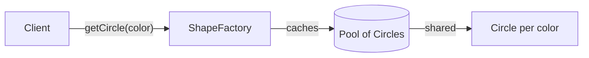
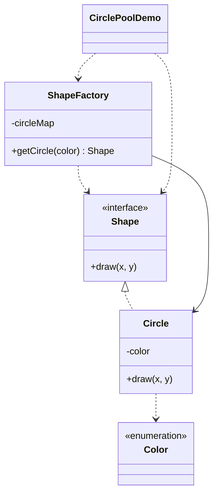

# Circle Pool — Flyweight

> Shares one `Circle` object per color, so many drawings reuse the same instances
> while passing coordinates as external state.

## Big Picture

## Scenario

A renderer draws thousands of circles in only a few colors. Creating a new object
per circle wastes memory. A factory keeps one circle per color and returns the
same instance, while each draw call passes only the external state (x, y).

## Design Pattern

**Flyweight** — uses sharing to support large numbers of fine-grained objects
efficiently, splitting intrinsic (shared) and extrinsic (per-call) state.

Why it fits:

- `Shape` is the **flyweight** interface; `Circle` is the concrete flyweight.
- Color is **intrinsic** (shared) state stored in the flyweight; x/y are
  **extrinsic** state passed to `draw`.
- `ShapeFactory` is the **flyweight factory** that caches circles by color.

## Structure

| Role | Participants |
|------|--------------|
| Flyweight | `Shape` |
| Concrete flyweight | `Circle` |
| Intrinsic state | `Color` |
| Flyweight factory | `ShapeFactory` |
| Client / demo | `CirclePoolDemo` |

## Design Rationale

- Color is the intrinsic state and lives in the object; x/y are passed per call,
  which is the canonical intrinsic/extrinsic split.
- `computeIfAbsent` keeps the cache logic one line and thread-safe enough for a demo.
- One file per type separates flyweight, factory and state.