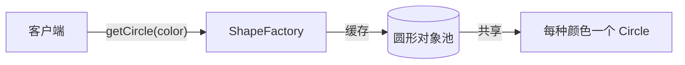
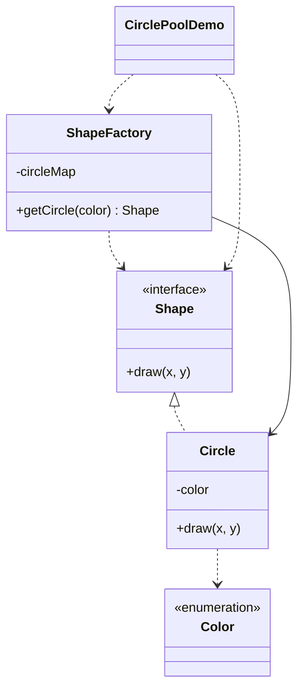

# 圆形共享 — 享元

> 每种颜色共享一个 `Circle` 对象，让大量绘制复用同一实例，坐标作为外部状态传入。

## 整体概览

## 场景描述

渲染器需要绘制成千上万个圆，但颜色只有几种。为每个圆新建对象会浪费内存。工厂
按颜色各保留一个圆并返回同一实例，每次 `draw` 只传入外部状态（x、y）。

## 设计模式

**享元** —— 运用共享技术高效地支持大量细粒度对象，拆分内部（共享）与外部（每次
调用传入）状态。

为什么匹配：

- `Shape` 是**享元**接口；`Circle` 是具体享元。
- 颜色是存在享元内的**内部**（共享）状态；x/y 是传给 `draw` 的**外部**状态。
- `ShapeFactory` 是按颜色缓存圆形的**享元工厂**。

## 结构

| 角色 | 参与者 |
|------|--------|
| 享元 | `Shape` |
| 具体享元 | `Circle` |
| 内部状态 | `Color` |
| 享元工厂 | `ShapeFactory` |
| 客户端 / 演示 | `CirclePoolDemo` |

## 设计理念

- 颜色是内部状态、存于对象内；x/y 每次调用传入，这是经典的内部/外部状态划分。
- `computeIfAbsent` 让缓存逻辑保持一行，也足够满足演示需要。
- 一个类型一个文件，享元、工厂与状态各归其位。