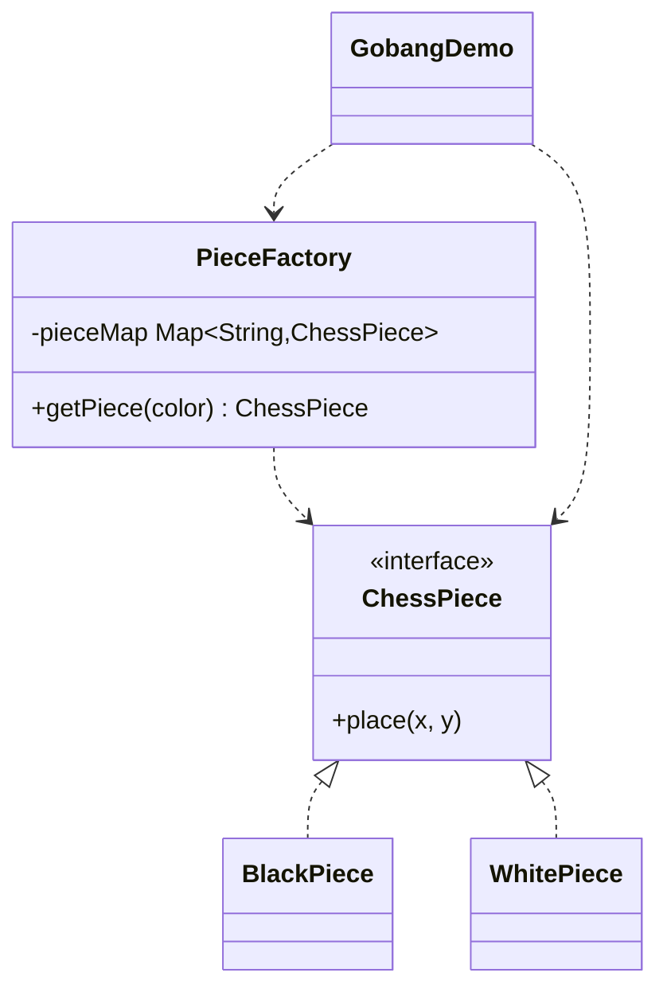

# Gobang Pieces — Flyweight

> Shares one black piece and one white piece across the whole board, passing
> the board coordinates as external state on each move.

## Big Picture

```mermaid
flowchart LR
    Demo[GobangDemo] --> F[PieceFactory]
    F --> B[BlackPiece]
    F --> W[WhitePiece]
    Demo -->|place(x, y)| B
    Demo -->|place(x, y)| W
```

## Scenario

A gobang board holds many black and white pieces. If each stone were a full
object, hundreds of pieces would be created. Since all black pieces are
identical except for their position, we share one black flyweight and one
white flyweight, and pass the coordinates to `place(x, y)` at each move.

## Design Pattern

**Flyweight** — shares fine-grained objects to support large numbers
efficiently.

Why it fits:

- The piece **color** is intrinsic (shared) state.
- The piece **position** `(x, y)` is extrinsic state, passed in per call.
- `PieceFactory` caches one piece per color and reuses it.

## Structure



| Role | Participants |
|------|--------------|
| Flyweight | `ChessPiece` |
| Concrete flyweights | `BlackPiece`, `WhitePiece` |
| Flyweight factory | `PieceFactory` |
| Client / demo | `GobangDemo` |

## Design Rationale

- The gobang scenario shows intrinsic (color) vs. extrinsic (coordinates)
  state clearly, distinct from the existing "Circle Pool" example.
- Reusing just two objects for the entire board demonstrates the memory
  savings directly.
- One file per type, following the Java convention, keeps each role readable.