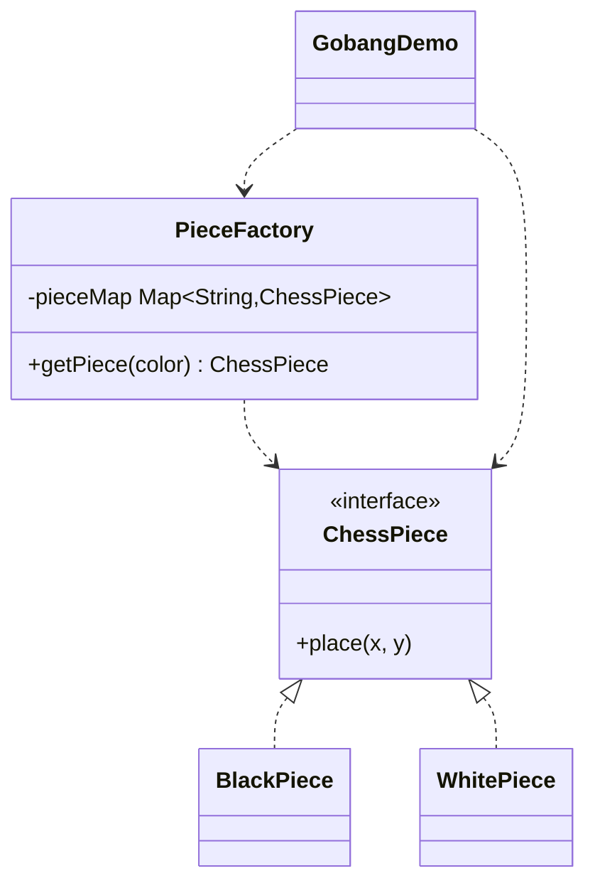

# 五子棋棋子 — 享元

> 整个棋盘共享一枚黑棋与一枚白棋，落子时把坐标作为外部状态传入。

## 整体概览

```mermaid
flowchart LR
    Demo[GobangDemo] --> F[PieceFactory]
    F --> B[BlackPiece]
    F --> W[WhitePiece]
    Demo -->|place(x, y)| B
    Demo -->|place(x, y)| W
```

## 场景描述

五子棋棋盘上有大量黑白棋子。如果每颗棋子都是完整对象，会创建成百上千个实例。
由于所有黑棋除位置外完全相同，我们共享一枚黑棋享元与一枚白棋享元，每次落子时把
坐标传入 `place(x, y)`。

## 设计模式

**享元** —— 共享细粒度对象，以高效支持大量对象。

为什么匹配：

- 棋子**颜色**是内部（共享）状态。
- 棋子**位置** `(x, y)` 是外部状态，每次调用时传入。
- `PieceFactory` 每种颜色缓存一枚棋子并复用。

## 结构



| 角色 | 参与者 |
|------|--------|
| 享元 | `ChessPiece` |
| 具体享元 | `BlackPiece`、`WhitePiece` |
| 享元工厂 | `PieceFactory` |
| 客户端 / 演示 | `GobangDemo` |

## 设计理念

- 五子棋场景直观展示内部状态（颜色）与外部状态（坐标）的区分，与"圆形共享"示例明显不同。
- 整个棋盘仅复用两个对象，直接体现内存节省。
- 遵循 Java 惯例一个类型一个文件，让每个角色都清晰可读。