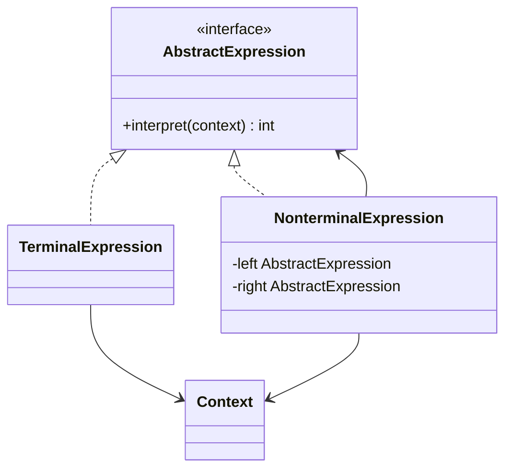

# Interpreter Pattern

> Given a language, defines a representation for its grammar along with an interpreter that uses the representation to interpret sentences in the language.

## Intent

Interpreter is a **behavioral** design pattern. It represents a language's grammar as an abstract syntax tree and provides an interpreter that walks and evaluates the tree to parse and compute specific languages or expressions.

## Problem

Sometimes you need to interpret and process a specific language or expression, involving parsing, analysis and execution, where the interpretation differs from case to case.

## Solution

Interpreter defines a grammar representation and an interpreter, expressing statements as an abstract syntax tree and evaluating the tree through recursive interpretation.

| Role | Description |
|------|-------------|
| Abstract expression | Declares the abstract interpret method |
| Terminal expression | Represents the smallest grammar unit |
| Non-terminal expression | Composed of terminals and other non-terminals |
| Context | Holds the information to be interpreted |

## Structure

- **AbstractExpression**: declares the unified interpret interface.
- **TerminalExpression**: handles the smallest grammar units.
- **NonterminalExpression**: recursively combines sub-expressions for interpretation.
- **Context**: holds the input and state needed for interpretation.

## Effects

**Pros**

- **Easy DSL implementation**: convenient for defining and executing domain-specific languages.
- **Extensible grammar**: new rules are added via new expression classes.

**Cons**

- **More classes**: every grammar rule needs an expression class.
- **Performance impact**: complex grammars can be expensive.

**When to use**

- When you need to interpret and process a specific language or expression, especially a custom DSL.

## Cases in this project

- [Boolean Expression](booleanexpression/README.md) — parses and evaluates boolean expressions.
- [Math Expression](mathexpression/README.md) — parses and evaluates arithmetic expressions.