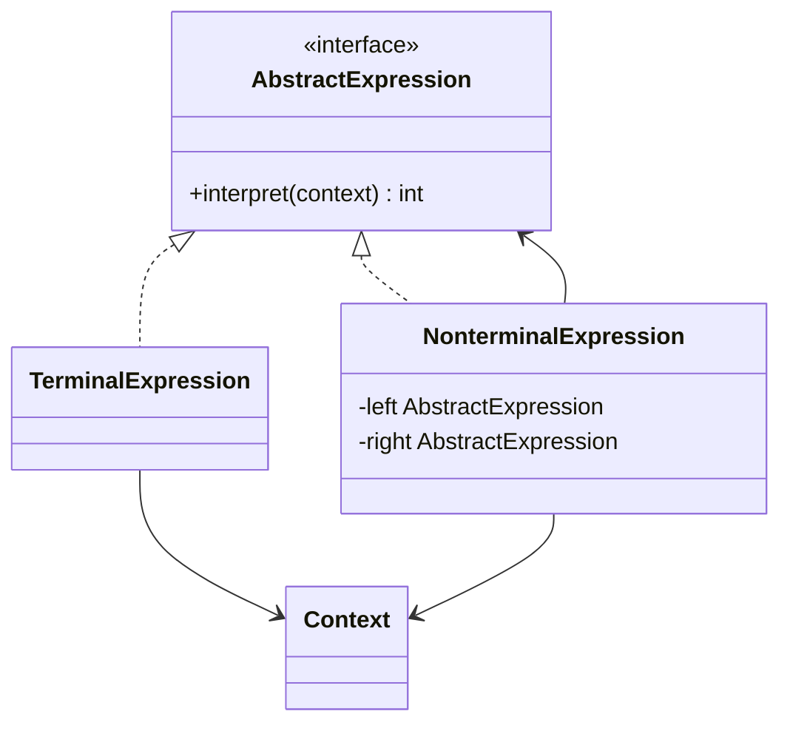

# 解释器模式（Interpreter）

> 给定一个语言，定义它的文法的一种表示，并定义一个解释器，这个解释器使用该表示来解释语言中的句子。

## 意图

解释器模式（Interpreter）是一种**行为型**设计模式。它把一种语言的文法表示为抽象语法树，并提供解释器逐步执行和解释这棵树，从而实现对特定语言或表达式的解析与求值。

## 问题

有时需要解释和处理一种特定语言或表达式，涉及解析、分析与执行，而不同场景下的解释方式各不相同。

## 解决方案

解释器模式定义文法表示并提供解释器，将语句表示为抽象语法树，通过递归解释器逐步执行语法树。

| 角色 | 说明 |
|------|------|
| 抽象表达式 | 定义抽象的解释方法 |
| 终结符表达式 | 表示语言中的最小语法单元 |
| 非终结符表达式 | 由终结符与其他非终结符组合而成 |
| 上下文 | 包含需要被解释的信息 |

## 结构

- **抽象表达式（AbstractExpression）**：声明统一的解释接口。
- **终结符表达式（TerminalExpression）**：处理最小语法单元。
- **非终结符表达式（NonterminalExpression）**：递归组合子表达式完成解释。
- **上下文（Context）**：保存解释所需的输入与状态。

## 效果

**优点**

- **易于实现 DSL**：便于定义与执行特定领域语言。
- **扩展语法**：新增规则只需新增表达式类。

**缺点**

- **类数量增加**：每条语法规则都需一个表达式类。
- **性能影响**：处理复杂语法时可能开销较大。

**适用场景**

- 需要解释与处理特定语言或表达式，尤其是自定义 DSL 的场景。

## 项目中的案例

- [布尔表达式](booleanexpression/README_zh.md) —— 用解释器解析并求值布尔表达式。
- [数学表达式](mathexpression/README_zh.md) —— 用解释器解析并求值算术表达式。