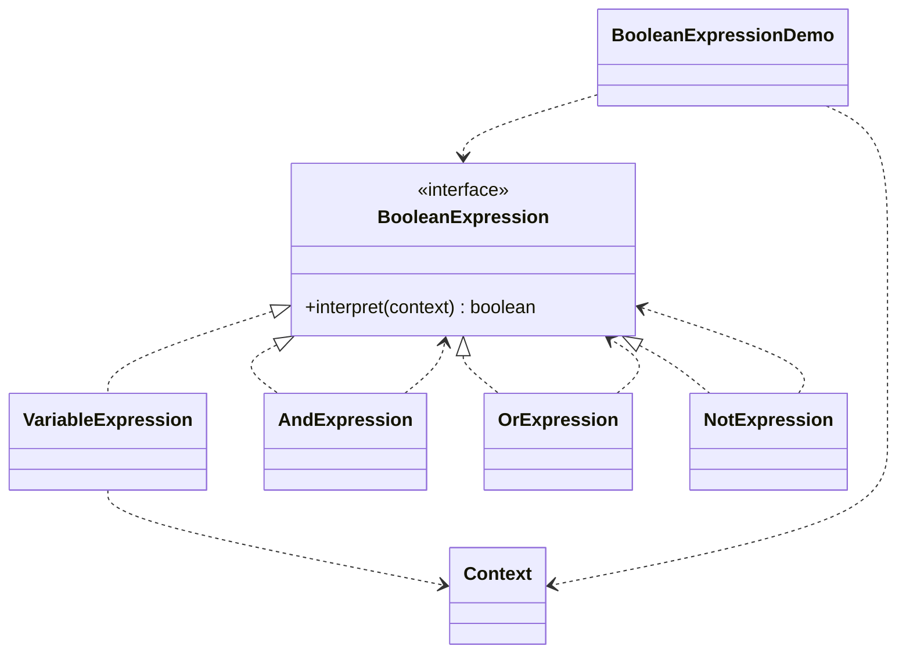

# Boolean Expression — Interpreter

> Composes variables with AND / OR / NOT into a tree that evaluates against a
> context of boolean assignments.

## Big Picture

```mermaid
flowchart LR
    Expr[(A AND B) OR (NOT C)] --> And[AndExpression]
    And --> A[VariableExpression A]
    And --> B[VariableExpression B]
    Expr --> Not[NotExpression]
    Not --> C[VariableExpression C]
```

## Scenario

A rule engine needs to evaluate boolean conditions built from variables and
operators. Each grammar element becomes an expression object that can
interpret itself against a `Context` of variable values, yielding `true` or
`false`.

## Design Pattern

**Interpreter** — defines a grammar and an interpreter for sentences in that
grammar.

Why it fits:

- `BooleanExpression` is the abstract expression (grammar).
- `VariableExpression` is terminal; `AndExpression`, `OrExpression`,
  `NotExpression` are non-terminal and combine sub-expressions.
- `Context` supplies variable values for interpretation.

## Structure



| Role | Participants |
|------|--------------|
| Abstract expression | `BooleanExpression` |
| Terminal expression | `VariableExpression` |
| Non-terminal expressions | `AndExpression`, `OrExpression`, `NotExpression` |
| Context | `Context` |
| Client / demo | `BooleanExpressionDemo` |

## Design Rationale

- The boolean-grammar scenario differs from "Math Expression" by targeting
  logic (boolean) instead of arithmetic (integer).
- Variable + AND/OR/NOT covers terminal vs. non-terminal roles cleanly.
- One file per type, following the Java convention, keeps each role readable.