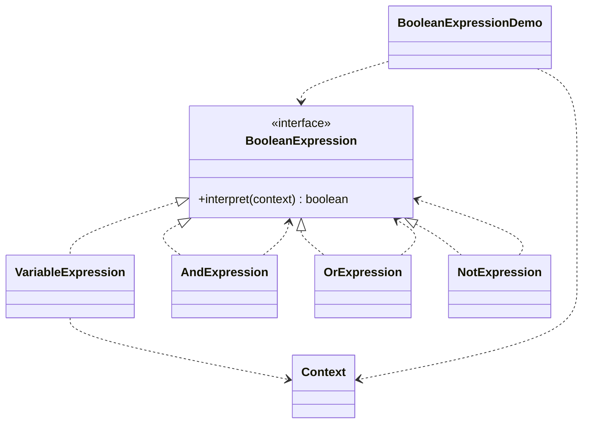

# 布尔表达式 — 解释器

> 用 AND / OR / NOT 组合变量构成表达式树，并针对布尔赋值上下文求值。

## 整体概览

```mermaid
flowchart LR
    Expr[(A AND B) OR (NOT C)] --> And[AndExpression]
    And --> A[VariableExpression A]
    And --> B[VariableExpression B]
    Expr --> Not[NotExpression]
    Not --> C[VariableExpression C]
```

## 场景描述

规则引擎需要计算由变量和运算符构成的布尔条件。每个语法元素成为一个表达式对象，
能针对变量值的 `Context` 自我解释，得出 `true` 或 `false`。

## 设计模式

**解释器** —— 定义文法及其句子的解释器。

为什么匹配：

- `BooleanExpression` 是抽象表达式（文法）。
- `VariableExpression` 是终结符；`AndExpression`、`OrExpression`、`NotExpression`
  是非终结符，负责组合子表达式。
- `Context` 提供解释所需的变量值。

## 结构



| 角色 | 参与者 |
|------|--------|
| 抽象表达式 | `BooleanExpression` |
| 终结符表达式 | `VariableExpression` |
| 非终结符表达式 | `AndExpression`、`OrExpression`、`NotExpression` |
| 上下文 | `Context` |
| 客户端 / 演示 | `BooleanExpressionDemo` |

## 设计理念

- 布尔文法的场景与"数学表达式"不同：针对逻辑（布尔）而非算术（整数）。
- 变量 + AND/OR/NOT 清晰地覆盖了终结符与非终结符两种角色。
- 遵循 Java 惯例一个类型一个文件，让每个角色都清晰可读。