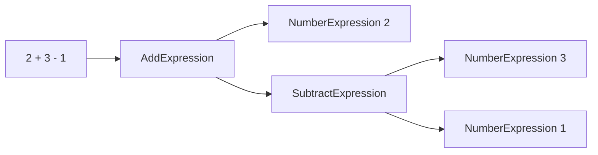
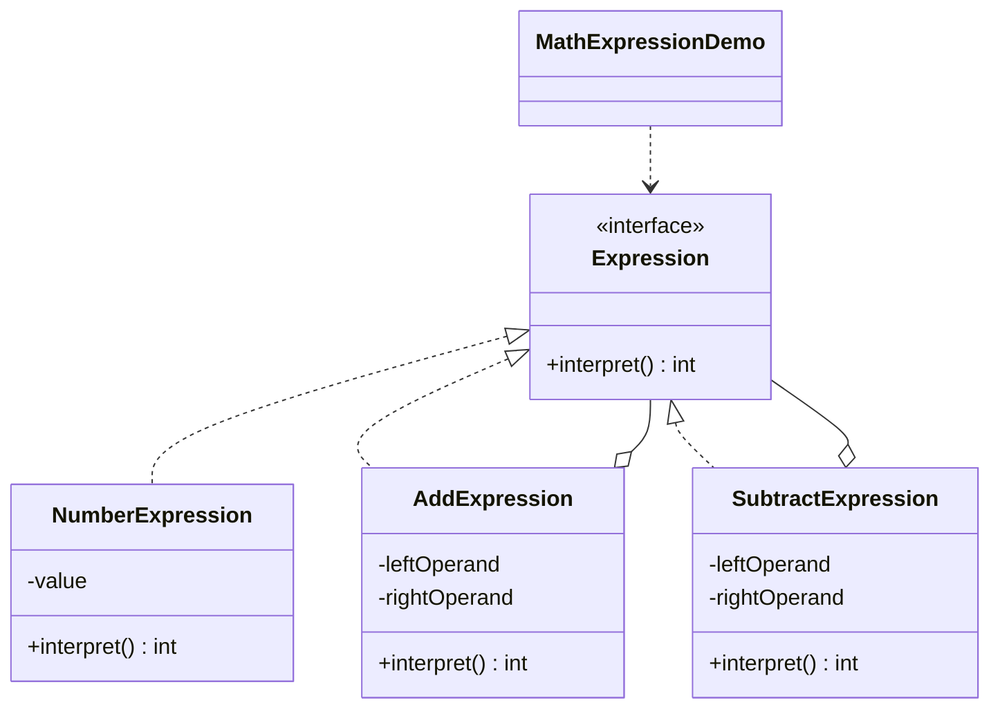

# Math Expression — Interpreter

> Builds a syntax tree of arithmetic expressions and evaluates it by walking the
> tree, translating a grammar into executable objects.

## Big Picture

## Scenario

A calculator needs to evaluate expressions like `2 + (3 - 1)`. Each number and
operator is represented by an expression object; evaluating the root expression
recursively evaluates its children and combines their results.

## Design Pattern

**Interpreter** — given a language, defines a representation for its grammar
along with an interpreter that uses the representation to interpret sentences.

Why it fits:

- `Expression` is the **abstract expression** with `interpret()`.
- `NumberExpression` is a **terminal expression**; `AddExpression` and
  `SubtractExpression` are **non-terminal expressions**.
- The demo builds an **abstract syntax tree** and calls `interpret()` on its root.

## Structure

| Role | Participants |
|------|--------------|
| Abstract expression | `Expression` |
| Terminal expression | `NumberExpression` |
| Non-terminal expressions | `AddExpression`, `SubtractExpression` |
| Client / demo | `MathExpressionDemo` |

## Design Rationale

- Recursive `interpret()` gives the tree evaluation for free: composite nodes
  combine their children's results.
- The demo uses a tiny grammar (numbers, +, -) so the mapping from grammar to
  classes stays obvious.
- One file per type separates terminal and non-terminal expressions.