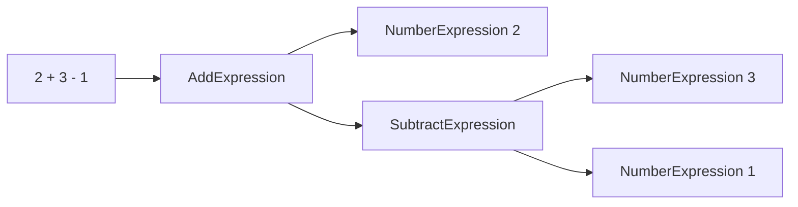
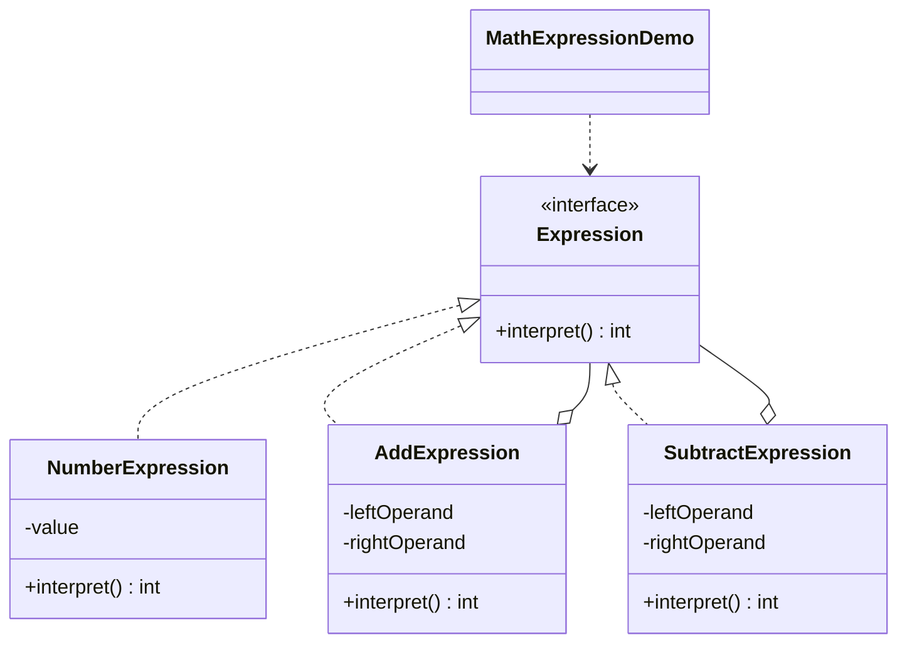

# 数学表达式 — 解释器

> 构建算术表达式的语法树并遍历求值，把一套文法翻译成可执行的对象。

## 整体概览

## 场景描述

计算器需要求值形如 `2 + (3 - 1)` 的表达式。每个数字和运算符都用一个表达式对象
表示；求值根表达式会递归求值其子表达式并合并结果。

## 设计模式

**解释器** —— 给定一门语言，定义其文法的表示，并定义一个使用该表示解释句子的
解释器。

为什么匹配：

- `Expression` 是带 `interpret()` 的**抽象表达式**。
- `NumberExpression` 是**终结符表达式**；`AddExpression` 和 `SubtractExpression`
  是**非终结符表达式**。
- 演示构建了一棵**抽象语法树**并调用其根节点的 `interpret()`。

## 结构

| 角色 | 参与者 |
|------|--------|
| 抽象表达式 | `Expression` |
| 终结符表达式 | `NumberExpression` |
| 非终结符表达式 | `AddExpression`、`SubtractExpression` |
| 客户端 / 演示 | `MathExpressionDemo` |

## 设计理念

- 递归的 `interpret()` 让树形求值水到渠成：组合节点合并子节点的结果。
- 演示使用极小的文法（数字、+、-），让「文法到类」的映射一目了然。
- 一个类型一个文件，终结符与非终结符表达式清晰分离。