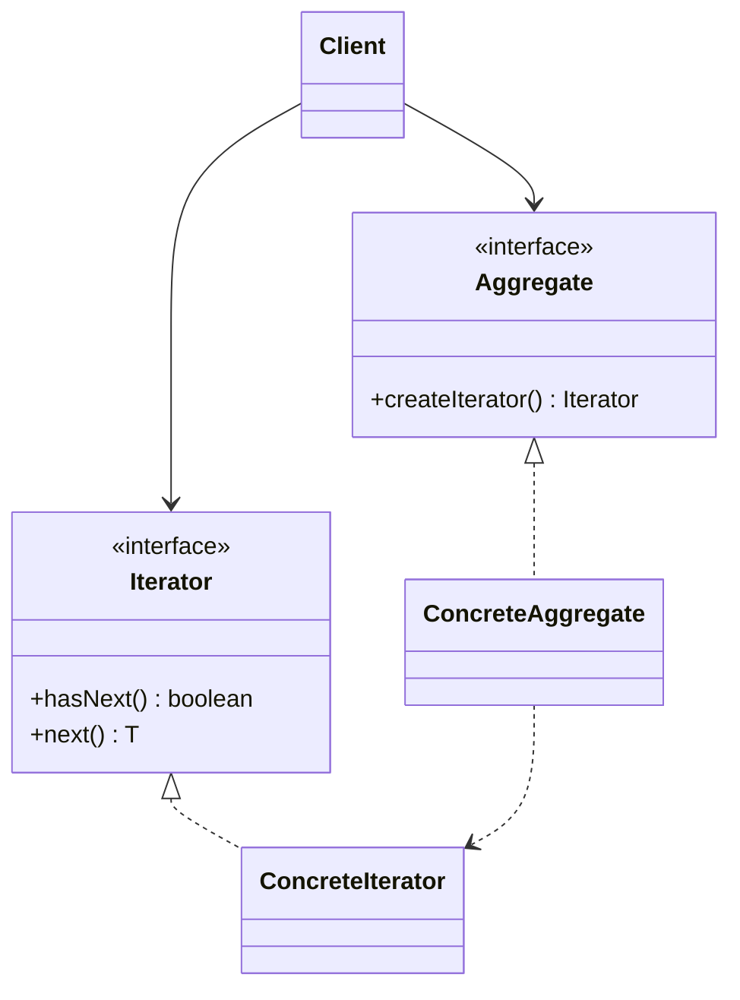

# Iterator Pattern

> Provides a way to access the elements of an aggregate object sequentially without exposing its underlying representation.

## Intent

Iterator is a **behavioral** design pattern. It separates traversal from the collection, offering a unified access interface so clients can visit elements sequentially without knowing the collection's internal structure.

## Problem

You often need to traverse different collections (lists, arrays, trees, etc.), but each has its own traversal approach, forcing clients to write different traversal logic and making the code complex and hard to maintain.

## Solution

Iterator separates "traversal" from "storage": the iterator handles traversal and offers a unified interface, while the collection stores the elements. Decoupled this way, the two can change independently.

| Role | Description |
|------|-------------|
| Iterator | Declares the traversal interface (`hasNext` / `next`) |
| Concrete iterator | Implements traversal and tracks the current position |
| Aggregate | Declares the interface for creating iterators |
| Concrete aggregate | Stores elements and returns a concrete iterator |

## Structure

- **Iterator**: declares the unified traversal interface.
- **ConcreteIterator**: implements traversal and tracks position.
- **Aggregate**: declares the interface for creating iterators.
- **ConcreteAggregate**: stores elements and returns an iterator.

## Effects

**Pros**

- **Simpler clients**: traversal is encapsulated in the iterator.
- **Lower coupling**: the collection's internal representation is not exposed.
- **Multiple traversals**: supports forward, reverse and other traversal styles.

**Cons**

- **More classes and interfaces**: can feel heavier in simple cases.

**When to use**

- When you need to traverse different collections uniformly without exposing their internals.

## Cases in this project

- [Playlist](playlist/README.md) — sequentially iterates over songs in a playlist.
- [Collection Iterator](collection/README.md) — uniformly iterates a custom collection.