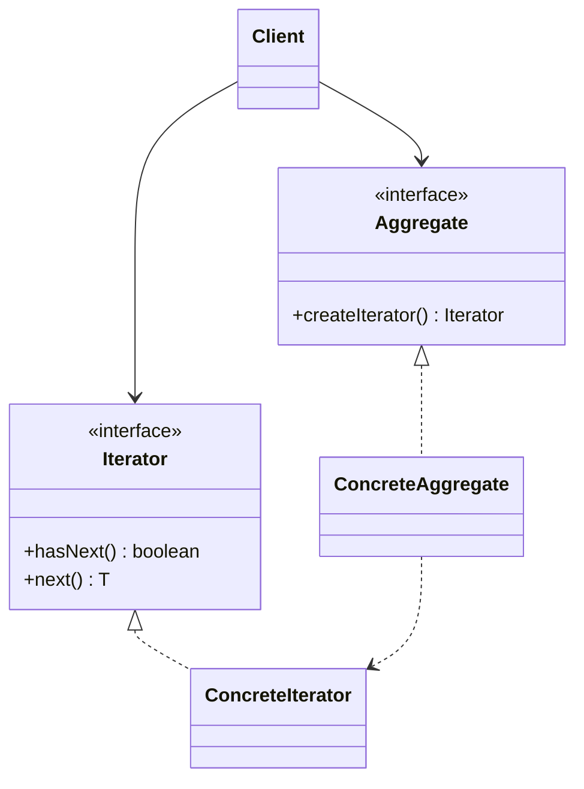

# 迭代器模式（Iterator）

> 提供一种方法顺序访问一个聚合对象中各个元素，而又不需暴露该对象的内部表示。

## 意图

迭代器模式（Iterator）是一种**行为型**设计模式。它把遍历逻辑从集合中分离出来，提供统一的访问接口，使客户端无需了解集合内部结构即可顺序访问元素。

## 问题

经常需要遍历不同集合（列表、数组、树等），但不同集合的遍历方式不同，导致客户端需要编写不同的遍历逻辑，代码复杂且难以维护。

## 解决方案

迭代器模式把「遍历」与「存储」分离：迭代器负责遍历并提供统一接口，集合负责存储元素。二者解耦后可以独立变化。

| 角色 | 说明 |
|------|------|
| 迭代器 | 声明遍历接口（`hasNext` / `next`） |
| 具体迭代器 | 实现遍历逻辑，维护当前遍历位置 |
| 聚合 | 声明创建迭代器的接口 |
| 具体聚合 | 存储元素并返回具体迭代器 |

## 结构

- **迭代器（Iterator）**：声明统一的遍历接口。
- **具体迭代器（ConcreteIterator）**：实现遍历，维护当前位置。
- **聚合（Aggregate）**：声明创建迭代器的接口。
- **具体聚合（ConcreteAggregate）**：存储元素并返回迭代器。

## 效果

**优点**

- **简化客户端**：遍历逻辑封装在迭代器中，客户端更简洁。
- **降低耦合**：不暴露集合内部表示。
- **多种遍历**：支持正向、逆向等不同遍历方式。

**缺点**

- **增加类与接口**：简单场景下可能略显复杂。

**适用场景**

- 需要统一遍历不同集合、且不暴露集合内部细节的场景。

## 项目中的案例

- [播放列表](playlist/README_zh.md) —— 用迭代器顺序遍历播放列表中的歌曲。
- [集合遍历](collection/README_zh.md) —— 用迭代器统一遍历自定义集合。