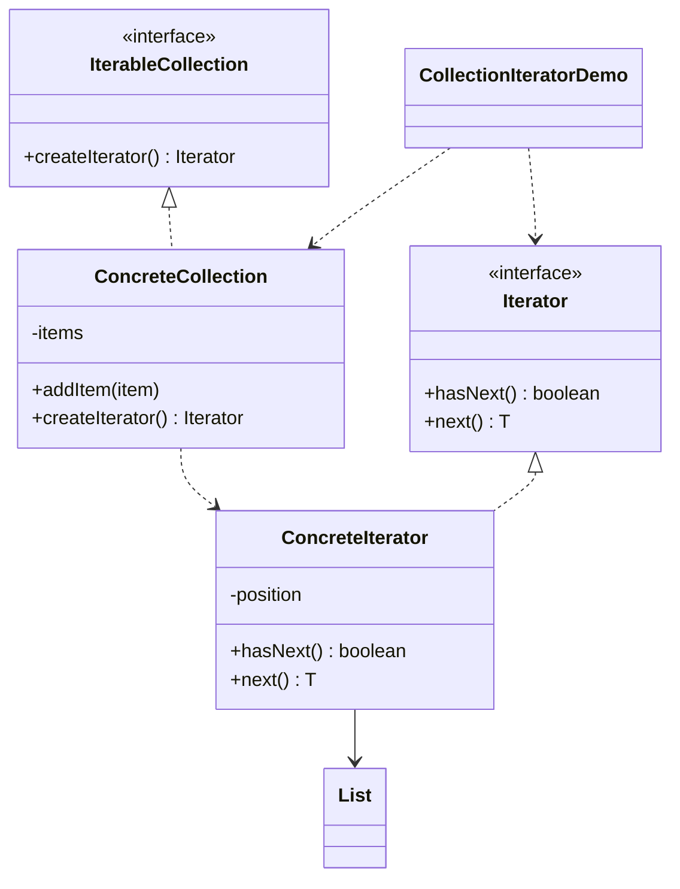

# Collection Iterator — Iterator

> Provides a standard way to traverse a custom collection without exposing its
> internal storage, decoupling traversal from the collection.

## Big Picture

```mermaid
flowchart LR
    C[Collection] -->|createIterator()| I[Iterator]
    I -->|hasNext / next| C
    Client[Client] --> I
```

## Scenario

A custom collection stores items in a list, but clients should be able to walk
through them without knowing the storage. A separate iterator encapsulates the
cursor position and exposes `hasNext()`/`next()`.

## Design Pattern

**Iterator** — provides a way to access the elements of an aggregate object
sequentially without exposing its underlying representation.

Why it fits:

- `IterableCollection` is the **aggregate**; `ConcreteCollection` is the concrete
  aggregate.
- `Iterator` is the **iterator**; `ConcreteIterator` keeps the cursor.
- The client only calls `hasNext()`/`next()`, never touching the internal `List`.

## Structure



| Role | Participants |
|------|--------------|
| Aggregate | `IterableCollection` |
| Concrete aggregate | `ConcreteCollection` |
| Iterator | `Iterator` |
| Concrete iterator | `ConcreteIterator` |
| Client / demo | `CollectionIteratorDemo` |

## Design Rationale

- The iterator hides the cursor and the list, so the collection's storage could
  change without affecting clients.
- `next()` throws on exhaustion, matching the safety expected of an iterator.
- One file per type separates aggregate and iterator responsibilities.