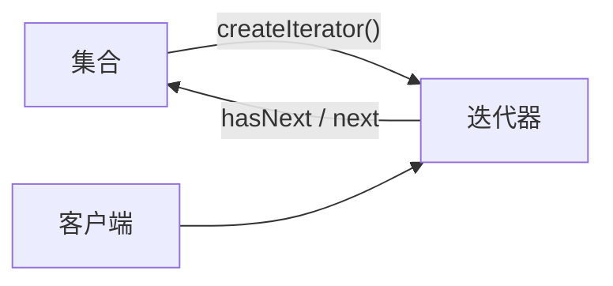
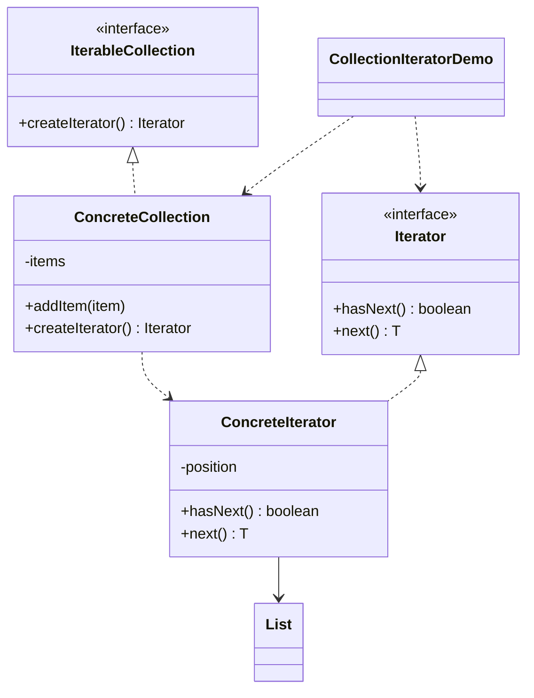

# 集合遍历 — 迭代器

> 提供遍历自定义集合的标准方式而无需暴露其内部存储，把遍历与集合解耦。

## 整体概览

## 场景描述

自定义集合用列表存储元素，但客户端应能在不了解存储结构的情况下遍历它们。独立
的迭代器封装游标位置并暴露 `hasNext()`/`next()`。

## 设计模式

**迭代器** —— 提供一种顺序访问聚合对象元素的方法，而不暴露其底层表示。

为什么匹配：

- `IterableCollection` 是**聚合**；`ConcreteCollection` 是具体聚合。
- `Iterator` 是**迭代器**；`ConcreteIterator` 维护游标。
- 客户端只调用 `hasNext()`/`next()`，从不接触内部 `List`。

## 结构

| 角色 | 参与者 |
|------|--------|
| 聚合 | `IterableCollection` |
| 具体聚合 | `ConcreteCollection` |
| 迭代器 | `Iterator` |
| 具体迭代器 | `ConcreteIterator` |
| 客户端 / 演示 | `CollectionIteratorDemo` |

## 设计理念

- 迭代器隐藏了游标与列表，集合的存储结构可更换而不影响客户端。
- `next()` 在遍历耗尽时抛异常，符合迭代器应有的安全性。
- 一个类型一个文件，聚合与迭代器职责分离。