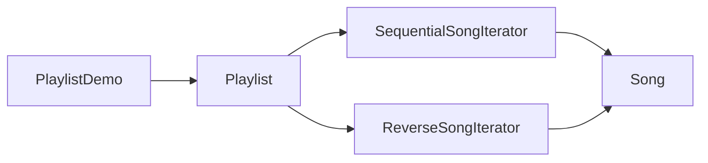
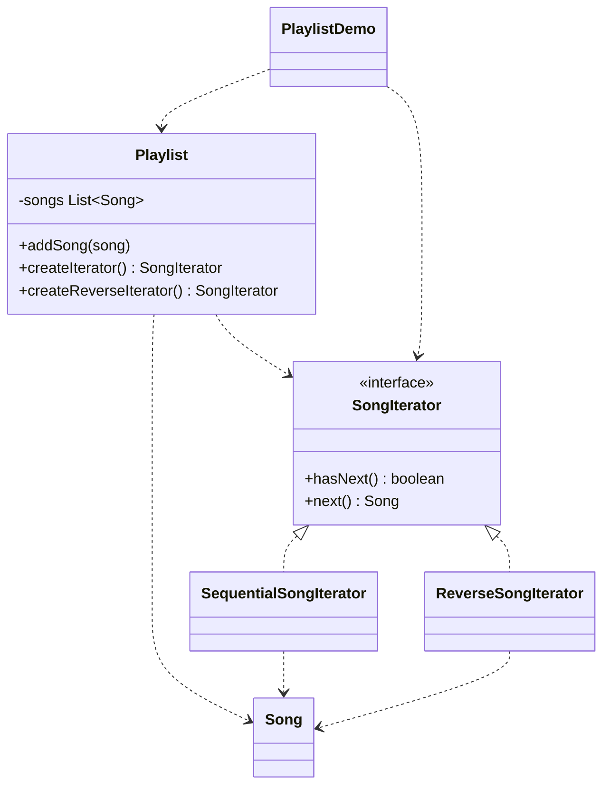

# Playlist — Iterator

> Walks a song list forward or in reverse without exposing the underlying
> storage to the client.

## Big Picture

## Scenario

A music player keeps an ordered playlist. The client wants to play songs in
order, or in reverse, without knowing how the playlist stores them. Each
iterator encapsulates a traversal strategy over the same collection.

## Design Pattern

**Iterator** — provides a way to access elements sequentially without
exposing the underlying representation.

Why it fits:

- `SongIterator` is the common traversal interface.
- `SequentialSongIterator` and `ReverseSongIterator` implement two traversal
  strategies.
- `Playlist` (aggregate) exposes `createIterator()` /
  `createReverseIterator()` instead of its internal list.

## Structure

| Role | Participants |
|------|--------------|
| Iterator | `SongIterator` |
| Concrete iterators | `SequentialSongIterator`, `ReverseSongIterator` |
| Aggregate | `Playlist` |
| Element | `Song` |
| Client / demo | `PlaylistDemo` |

## Design Rationale

- The playlist scenario adds multiple traversal strategies, distinct from the
  generic "Collection Iterator" example.
- Forward and reverse iterators show how different strategies hide the same
  storage.
- One file per type, following the Java convention, keeps each role readable.