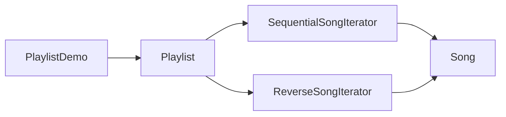
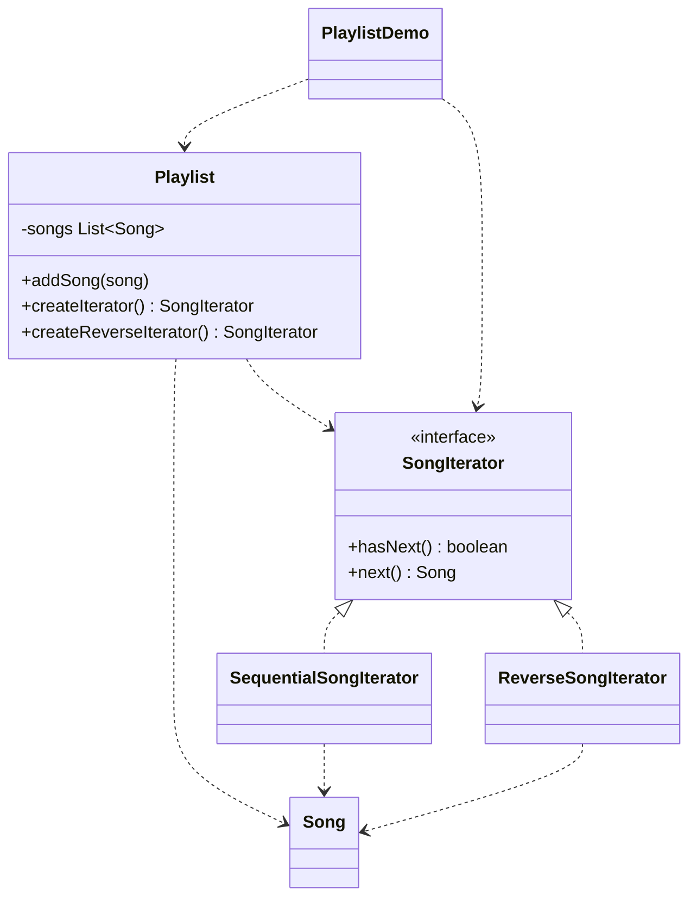

# 播放列表 — 迭代器

> 顺序或逆序地遍历歌曲列表，而不向客户端暴露底层存储。

## 整体概览

## 场景描述

音乐播放器维护一个有序播放列表。客户端想按顺序或逆序播放歌曲，却无需知道列表内部
如何存储。每种迭代器封装了对同一集合的一种遍历策略。

## 设计模式

**迭代器** —— 提供一种顺序访问元素的方式，而不暴露底层表示。

为什么匹配：

- `SongIterator` 是统一的遍历接口。
- `SequentialSongIterator`、`ReverseSongIterator` 实现两种遍历策略。
- `Playlist`（聚合对象）暴露 `createIterator()` / `createReverseIterator()`，
  而非暴露内部列表。

## 结构

| 角色 | 参与者 |
|------|--------|
| 迭代器 | `SongIterator` |
| 具体迭代器 | `SequentialSongIterator`、`ReverseSongIterator` |
| 聚合对象 | `Playlist` |
| 元素 | `Song` |
| 客户端 / 演示 | `PlaylistDemo` |

## 设计理念

- 播放列表场景加入了多种遍历策略，与泛型的"集合遍历"示例明显区分。
- 顺序与逆序两种迭代器展示了不同策略如何隐藏同一份存储。
- 遵循 Java 惯例一个类型一个文件，让每个角色都清晰可读。