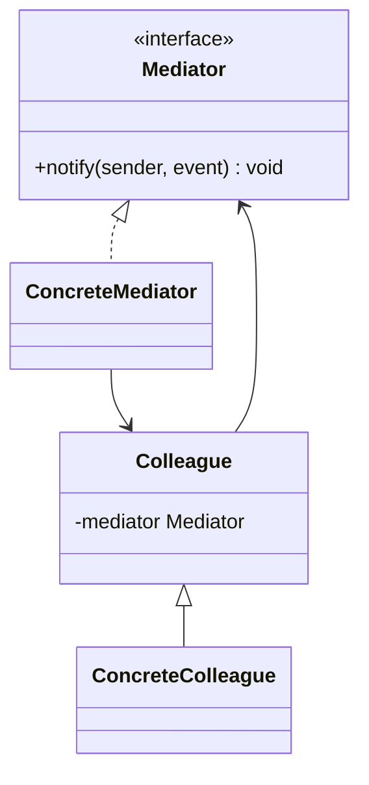

# Mediator Pattern

> Defines an object that encapsulates how a set of objects interact, promoting loose coupling by keeping objects from referring to each other explicitly.

## Intent

Mediator is a **behavioral** design pattern. It centralizes complex interactions between objects into a mediator; objects no longer communicate directly but exchange messages through the mediator, reducing coupling and easing maintenance.

## Problem

Communication between objects can become complex, creating mutual dependencies that are hard to manage. When interaction logic gets tangled, it needs to be centralized to reduce coupling and improve maintainability.

## Solution

Mediator introduces a mediator object that coordinates communication between objects. Each object focuses on its own responsibility and exchanges messages through the mediator without knowing others' details.

| Role | Description |
|------|-------------|
| Mediator | Declares the interface for inter-object communication |
| Concrete mediator | Implements the coordination logic and manages colleague objects |
| Colleague | Holds a mediator reference and communicates through it |

## Structure

- **Mediator**: declares the communication interface.
- **ConcreteMediator**: implements coordination logic and holds colleague references.
- **Colleague**: holds a mediator reference and interacts through it.

## Effects

**Pros**

- **Lower coupling**: communication is centralized in the mediator.
- **Centralized management**: interaction logic is clear and easy to modify.
- **Reusability**: interaction logic is separated from business logic.
- **Extensible**: adding/removing colleagues or changing the mediator is straightforward.

**Cons**

- **Mediator bloat**: poor design can make the mediator itself overly complex.

**When to use**

- When interactions between objects are complex and need centralization and decoupling.

## Cases in this project

- [Air Traffic](airtraffic/README.md) — coordinates communication among multiple aircraft.
- [Chat Room](chatroom/README.md) — forwards user messages through a mediator.