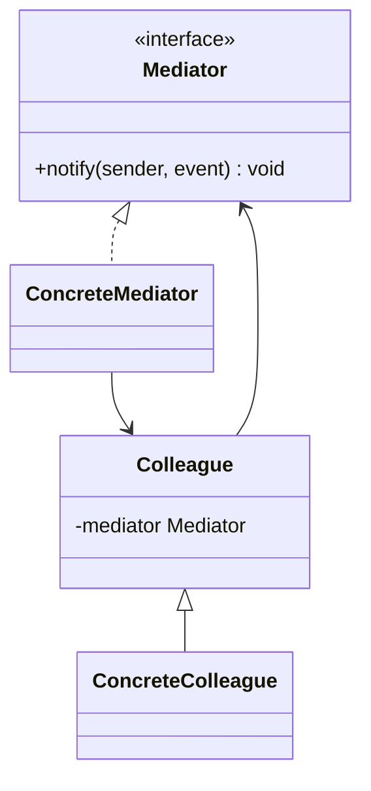

# 中介者模式（Mediator）

> 用一个中介对象来封装一系列的对象交互，使各对象不需要显式地相互引用，从而使其耦合松散。

## 意图

中介者模式（Mediator）是一种**行为型**设计模式。它把对象间的复杂交互集中到一个中介者中，对象不再直接互相通信，而是通过中介者收发消息，从而降低耦合、便于维护。

## 问题

系统中对象之间的通信可能变得复杂，导致对象相互依赖、难以管理。当通信逻辑混乱时，需要集中管理以降低耦合、提高可维护性。

## 解决方案

中介者模式引入中介者对象，统一协调对象间的通信。对象只关注自身职责，通过中介者收发消息，无需了解其他对象细节。

| 角色 | 说明 |
|------|------|
| 中介者 | 声明对象间通信的接口 |
| 具体中介者 | 实现通信协调逻辑，管理各同事对象 |
| 同事 | 持有中介者引用，通过中介者与其他同事通信 |

## 结构

- **中介者（Mediator）**：声明通信接口。
- **具体中介者（ConcreteMediator）**：实现协调逻辑，维护同事引用。
- **同事（Colleague）**：持有中介者引用，通过中介者交互。

## 效果

**优点**

- **降低耦合**：对象间通信集中到中介者，减少直接依赖。
- **集中管理**：交互逻辑清晰可见，便于维护与修改。
- **复用性**：交互逻辑与业务逻辑分离，便于复用。
- **可扩展**：增删同事或修改中介者即可扩展，无需改动对象间通信。

**缺点**

- **中介者易膨胀**：设计不当会使中介者本身过于复杂。

**适用场景**

- 对象间交互复杂、需要集中管理与解耦的场景。

## 项目中的案例

- [空中交通](airtraffic/README_zh.md) —— 用中介者协调多架飞机的通信。
- [聊天室](chatroom/README_zh.md) —— 用中介者统一转发用户消息。