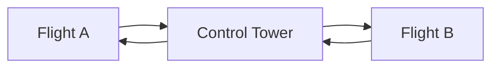
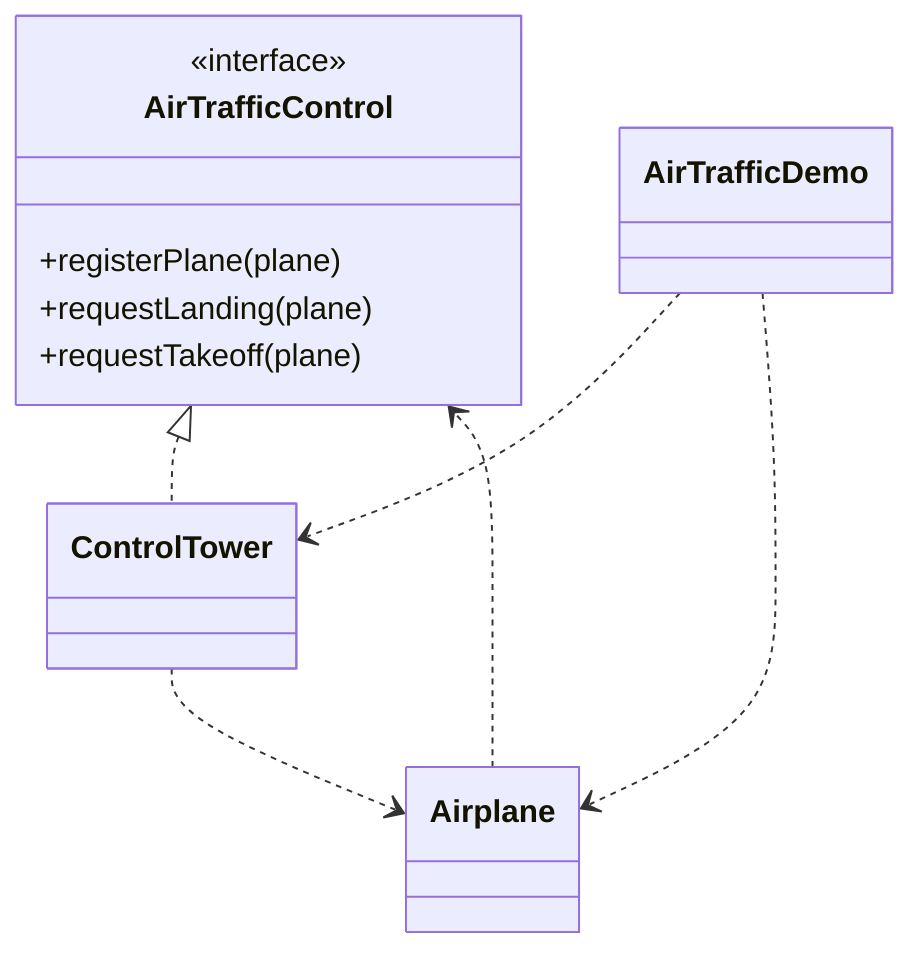

# Air Traffic — Mediator

> Planes coordinate landing and takeoff only through a control tower, never
> talking to each other directly.

## Big Picture

## Scenario

A single runway serves multiple aircraft. Without coordination, planes would
have to negotiate with every other plane. Instead, a control tower centralizes
the runway state and grants landing or takeoff permission, so colleagues
remain loosely coupled.

## Design Pattern

**Mediator** — centralizes communication between colleagues to reduce direct
coupling.

Why it fits:

- `AirTrafficControl` is the mediator contract.
- `ControlTower` centralizes runway availability and routes decisions.
- `Airplane` (colleague) only talks to the tower, never to other planes.

## Structure

| Role | Participants |
|------|--------------|
| Mediator | `AirTrafficControl` |
| Concrete mediator | `ControlTower` |
| Colleague | `Airplane` |
| Client / demo | `AirTrafficDemo` |

## Design Rationale

- The tower scenario adds shared-resource coordination, distinct from the
  "Chat Room" (message broadcast) example.
- The single-runway rule shows how a mediator enforces a policy colleagues
  cannot see directly.
- One file per type, following the Java convention, keeps each role readable.