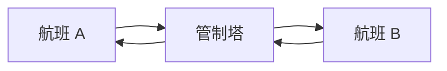
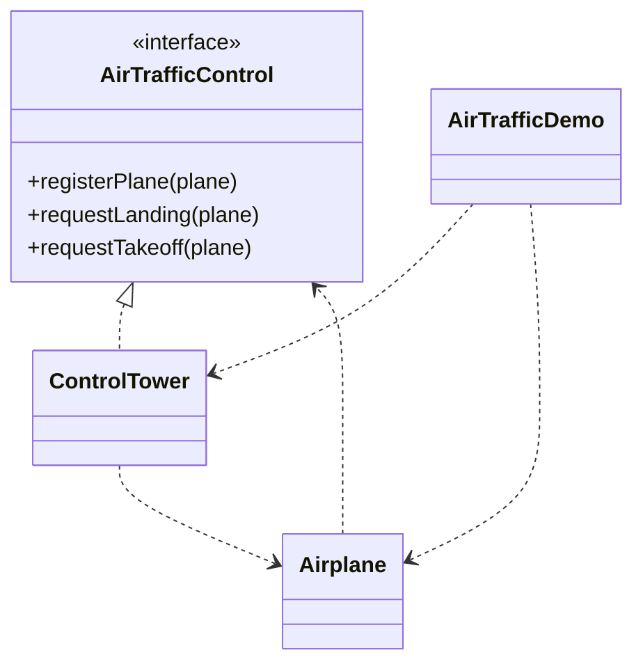

# 空中交通 — 中介者

> 飞机只通过管制塔协调起降，彼此之间从不直接沟通。

## 整体概览

## 场景描述

一条跑道服务于多架飞机。若没有协调，飞机之间必须两两协商。相反，管制塔集中管理
跑道状态，统一发放降落或起飞许可，使各同事对象保持松耦合。

## 设计模式

**中介者** —— 集中同事之间的通信，减少彼此的直接耦合。

为什么匹配：

- `AirTrafficControl` 是中介者契约。
- `ControlTower` 集中管理跑道可用性并做出调度决策。
- `Airplane`（同事）只与塔台沟通，从不直接联系其他飞机。

## 结构

| 角色 | 参与者 |
|------|--------|
| 中介者 | `AirTrafficControl` |
| 具体中介者 | `ControlTower` |
| 同事 | `Airplane` |
| 客户端 / 演示 | `AirTrafficDemo` |

## 设计理念

- 塔台场景加入了共享资源（跑道）的协调，与"聊天室"（消息广播）示例明显区分。
- 单跑道规则展示了中介者如何执行同事彼此不可见的调度策略。
- 遵循 Java 惯例一个类型一个文件，让每个角色都清晰可读。