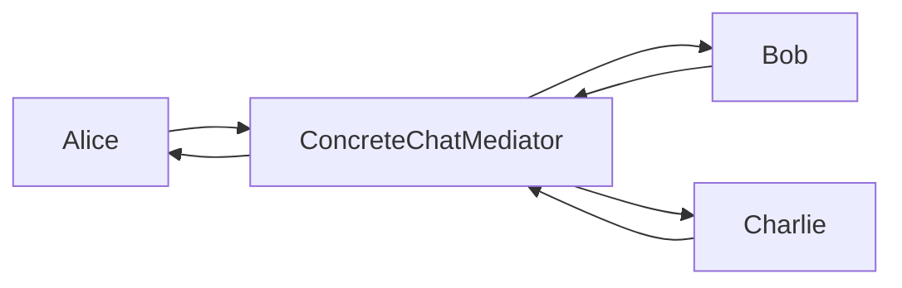
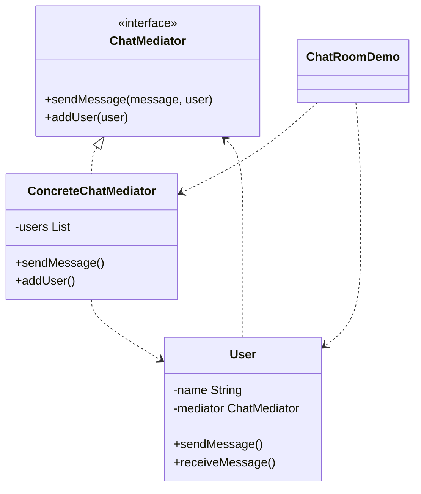

# Chat Room — Mediator

> Users send messages through a central chat room instead of talking to each
> other directly, decoupling them from one another.

## Big Picture

## Scenario

In a group chat, each user would otherwise need references to every other user.
A mediator (the chat room) centralizes message delivery: a user sends to the
mediator, and the mediator forwards to everyone else.

## Design Pattern

**Mediator** — defines an object that encapsulates how a set of objects interact,
promoting loose coupling.

Why it fits:

- `ChatMediator` is the **mediator** interface; `ConcreteChatMediator` is the
  concrete mediator that holds all users.
- `User` is the **colleague** that talks only to the mediator.
- Users never reference each other directly, only the mediator.

## Structure

| Role | Participants |
|------|--------------|
| Mediator | `ChatMediator` |
| Concrete mediator | `ConcreteChatMediator` |
| Colleague | `User` |
| Client / demo | `ChatRoomDemo` |

## Design Rationale

- Colleagues are decoupled: `User` depends only on `ChatMediator`, not on other
  users.
- The mediator centralizes routing logic (send to everyone except the sender).
- Adding a user or changing routing only touches the mediator.