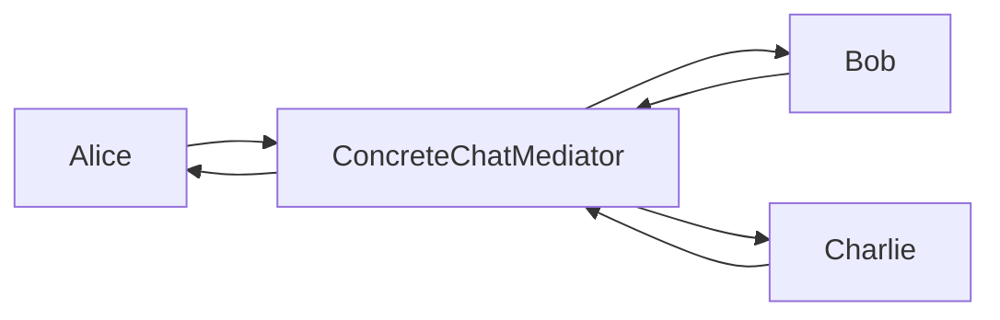
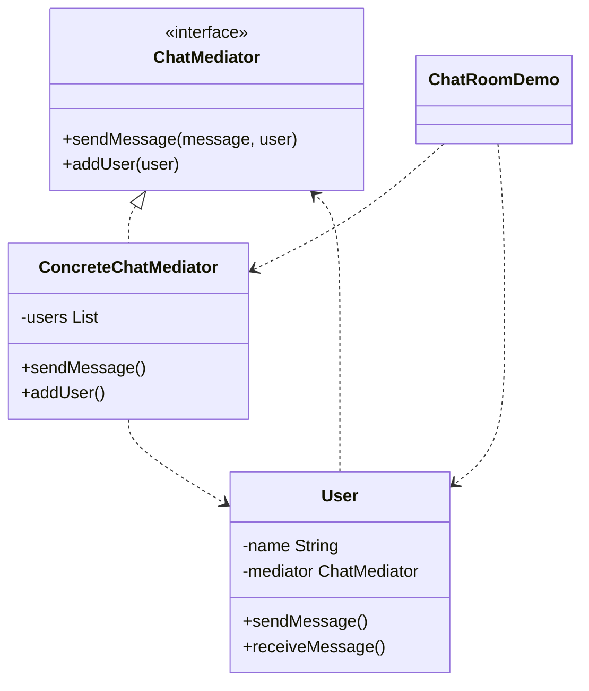

# 聊天室 — 中介者

> 用户通过中央聊天室发送消息，而非直接互相通信，从而彼此解耦。

## 整体概览

## 场景描述

在群聊中，若没有中介者，每个用户都要持有其他所有用户的引用。中介者（聊天室）
集中处理消息投递：用户发给中介者，中介者再转发给其他人。

## 设计模式

**中介者** —— 定义一个对象来封装一组对象之间的交互方式，促进松耦合。

为什么匹配：

- `ChatMediator` 是**中介者**接口；`ConcreteChatMediator` 是持有所有用户的
  具体中介者。
- `User` 是只与中介者通信的**同事**。
- 用户之间从不直接互相引用，只引用中介者。

## 结构

| 角色 | 参与者 |
|------|--------|
| 中介者 | `ChatMediator` |
| 具体中介者 | `ConcreteChatMediator` |
| 同事 | `User` |
| 客户端 / 演示 | `ChatRoomDemo` |

## 设计理念

- 同事之间解耦：`User` 只依赖 `ChatMediator`，不依赖其他用户。
- 中介者集中了路由逻辑（转发给除发送者外的所有人）。
- 新增用户或改变路由只需改动中介者。