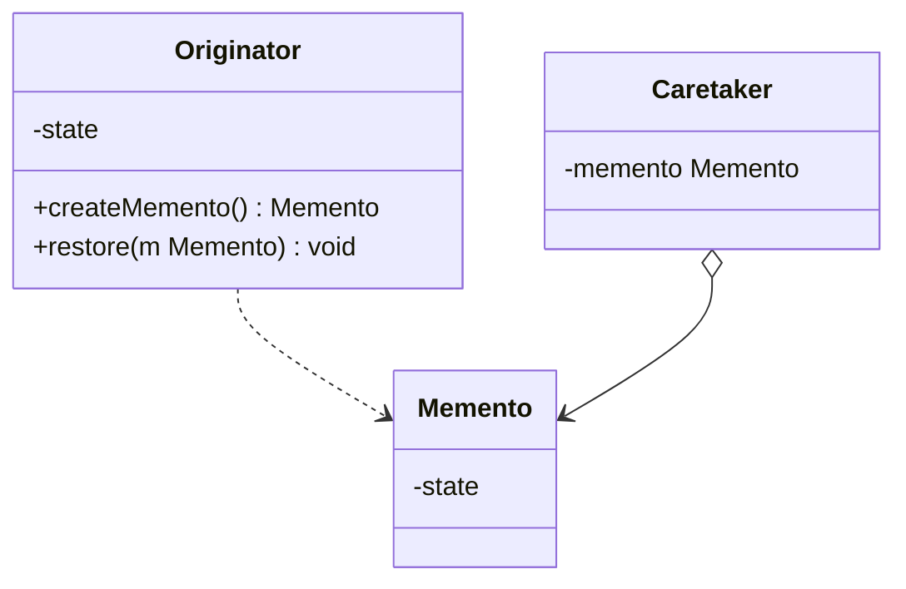

# Memento Pattern

> Without violating encapsulation, captures and externalizes an object's internal state so the object can be restored to this state later.

## Intent

Memento is a **behavioral** design pattern. It captures and saves an object's state without exposing its internal structure, and provides a restore mechanism for undo, history and snapshots.

## Problem

You often need to record an object's internal state and roll back to a previous state, for example to implement undo or history features.

## Solution

Memento introduces a memento object to hold the originator's state: the originator creates and restores mementos, while the caretaker stores and manages them — all without exposing the originator's internals.

| Role | Description |
|------|-------------|
| Originator | The object whose state is recorded; creates and restores mementos |
| Memento | Stores the originator's state without exposing its structure |
| Caretaker | Stores and manages multiple mementos for restoration |

## Structure

- **Originator**: creates a memento to save current state, and restores from a memento.
- **Memento**: encapsulates the originator's state.
- **Caretaker**: saves and retrieves mementos without operating on their content.

## Effects

**Pros**

- **Flexible state management**: saves and restores state without exposing internals.
- **Undo/redo support**: enables history and snapshot features.

**Cons**

- **Memory overhead**: storing large state histories consumes memory.

**When to use**

- When you need to record and restore object state for undo, redo or snapshots.

## Cases in this project

- [Game Save](gamesave/README.md) — saves and restores game progress via mementos.
- [Text Editor](texteditor/README.md) — implements undo and restore for text via mementos.