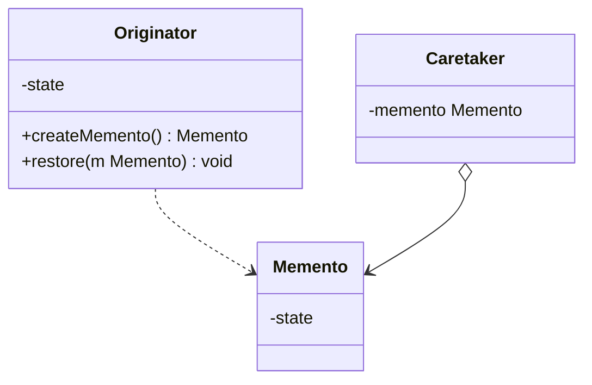

# 备忘录模式（Memento）

> 在不破坏封装性的前提下，捕获一个对象的内部状态，并在该对象之外保存这个状态，以便之后能将该对象恢复到原先保存的状态。

## 意图

备忘录模式（Memento）是一种**行为型**设计模式。它在不暴露对象内部结构的前提下，捕获并保存对象的状态，并提供恢复机制，用于实现撤销、历史记录与快照。

## 问题

经常需要记录对象的内部状态，并在需要时回滚到先前的状态，例如实现撤销操作或历史记录功能。

## 解决方案

备忘录模式引入备忘录对象保存发起人的状态：发起人创建并恢复备忘录，负责人负责保存与管理多个备忘录，全程不暴露发起人的内部结构。

| 角色 | 说明 |
|------|------|
| 发起人 | 需要记录状态的对象，创建并恢复备忘录 |
| 备忘录 | 存储发起人的状态，不直接暴露内部结构 |
| 负责人 | 保存与管理多个备忘录，用于状态恢复 |

## 结构

- **发起人（Originator）**：创建备忘录保存当前状态，也可从备忘录恢复。
- **备忘录（Memento）**：封装发起人状态。
- **负责人（Caretaker）**：保存与读取备忘录，但不操作其内容。

## 效果

**优点**

- **灵活的状态管理**：不暴露内部结构即可保存与恢复状态。
- **支持撤销/重做**：便于实现历史记录与快照。

**缺点**

- **内存开销**：保存大量状态历史会增加内存消耗。

**适用场景**

- 需要记录并恢复对象状态，实现撤销、重做、快照等功能的场景。

## 项目中的案例

- [游戏存档](gamesave/README_zh.md) —— 用备忘录保存与恢复游戏进度。
- [文本编辑器](texteditor/README_zh.md) —— 用备忘录实现文本的撤销与恢复。