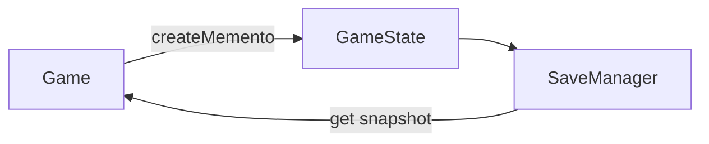
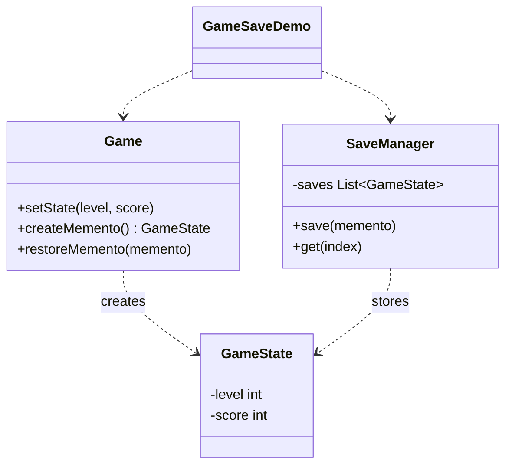

# Game Save — Memento

> Captures a game's progress into multiple checkpoints and restores any
> snapshot without exposing its internal fields.

## Big Picture

## Scenario

A game stores progress at several checkpoints. The player can later load any
snapshot. The game owns its state and produces the snapshots, while a save
manager just holds them without touching their contents.

## Design Pattern

**Memento** — captures and externalizes an object's internal state so it can
be restored later, without violating encapsulation.

Why it fits:

- `GameState` is the immutable memento.
- `Game` (originator) creates and restores mementos.
- `SaveManager` (caretaker) keeps a list of snapshots and never inspects them.

## Structure

| Role | Participants |
|------|--------------|
| Memento | `GameState` |
| Originator | `Game` |
| Caretaker | `SaveManager` |
| Client / demo | `GameSaveDemo` |

## Design Rationale

- The multi-checkpoint scenario adds a snapshot list, distinct from the single
  state in the "Text Editor" example.
- Multiple fields (level + score) show a richer state than a plain string.
- One file per type, following the Java convention, keeps each role readable.