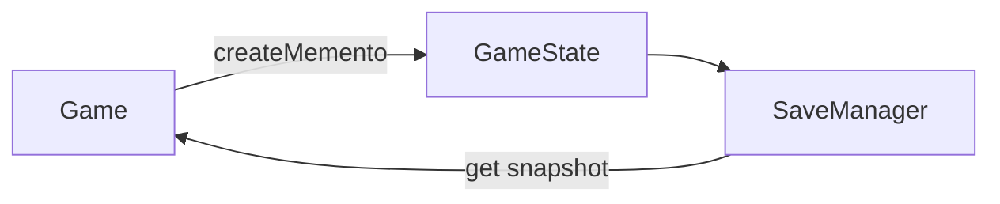
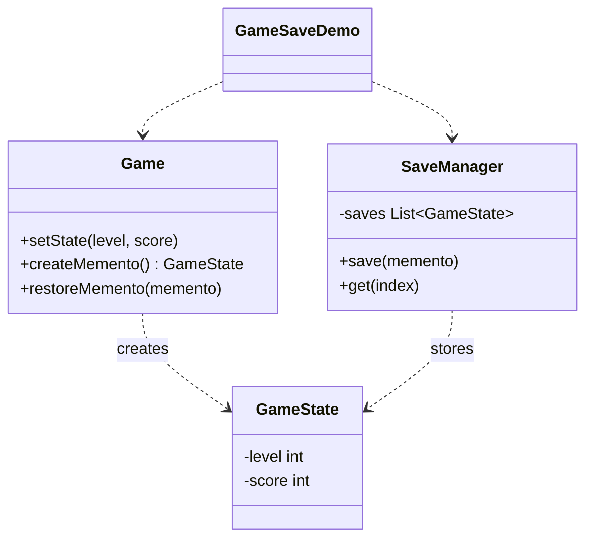

# 游戏存档 — 备忘录

> 把游戏进度捕获为多个存档点，并在不暴露内部字段的前提下恢复任意快照。

## 整体概览

## 场景描述

游戏在多个检查点保存进度，玩家随后可以加载任意存档。游戏自身持有状态并生成快照，
而存档管理器只是保管快照，不触碰其内容。

## 设计模式

**备忘录** —— 捕获并外置对象的内部状态，以便后续在不破坏封装的前提下恢复。

为什么匹配：

- `GameState` 是不可变的备忘录。
- `Game`（发起者）创建并恢复备忘录。
- `SaveManager`（负责人）保管快照列表，从不查看其内容。

## 结构

| 角色 | 参与者 |
|------|--------|
| 备忘录 | `GameState` |
| 发起者 | `Game` |
| 负责人 | `SaveManager` |
| 客户端 / 演示 | `GameSaveDemo` |

## 设计理念

- 多存档点场景加入了快照列表，与"文本编辑器"的单状态示例明显区分。
- 多个字段（关卡 + 分数）展示了比纯字符串更丰富的状态。
- 遵循 Java 惯例一个类型一个文件，让每个角色都清晰可读。