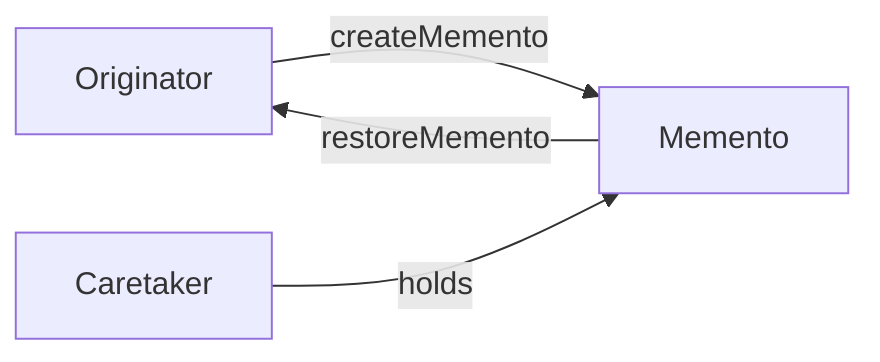
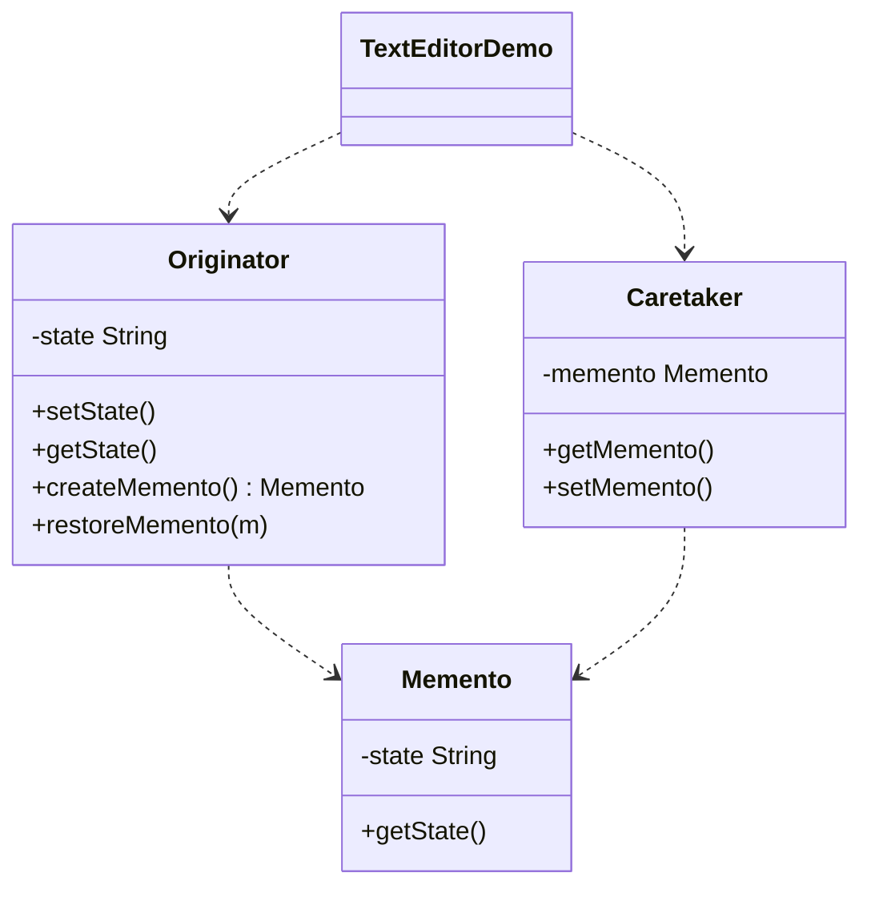

# Text Editor — Memento

> Saves and restores a text editor's state using a memento, enabling undo-like
> rollback without exposing the editor's internals.

## Big Picture

## Scenario

A text editor changes its state over time and needs to revert to a previous
state. The originator saves snapshots (mementos) and the caretaker keeps them,
so the state can be restored on demand.

## Design Pattern

**Memento** — captures and externalizes an object's internal state without
violating encapsulation, so the object can be restored later.

Why it fits:

- `Originator` creates and restores mementos (`createMemento()`/`restoreMemento()`).
- `Memento` stores a snapshot of the state.
- `Caretaker` holds the memento but never inspects or modifies it.

## Structure

| Role | Participants |
|------|--------------|
| Originator | `Originator` |
| Memento | `Memento` |
| Caretaker | `Caretaker` |
| Client / demo | `TextEditorDemo` |

## Design Rationale

- The memento keeps the state private, so the originator's internals stay
  encapsulated.
- The caretaker only stores the memento, keeping a clean separation between
  state management and history management.
- Save/restore are symmetric, giving a simple undo-like rollback.