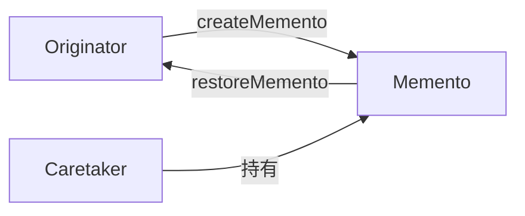
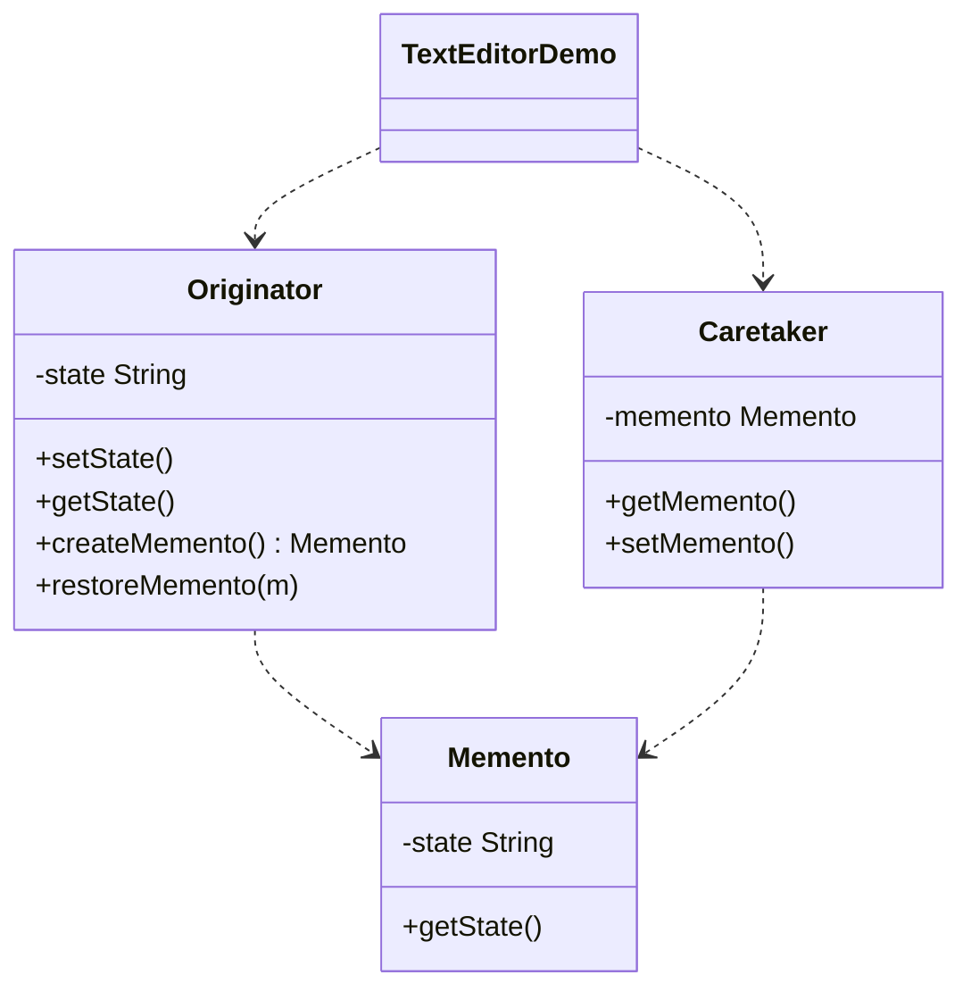

# 文本编辑器 — 备忘录

> 用备忘录保存并恢复文本编辑器的状态，实现类似撤销的回滚，且不暴露内部细节。

## 整体概览

## 场景描述

文本编辑器的状态随时间变化，需要能回到之前的状态。发起者保存快照（备忘录），
负责人保管它们，以便按需恢复。

## 设计模式

**备忘录** —— 在不破坏封装的前提下捕获并外部化对象的内部状态，以便日后恢复。

为什么匹配：

- `Originator` 创建并恢复备忘录（`createMemento()`/`restoreMemento()`）。
- `Memento` 存储状态的快照。
- `Caretaker` 保管备忘录，但从不查看或修改其内容。

## 结构

| 角色 | 参与者 |
|------|--------|
| 发起者 | `Originator` |
| 备忘录 | `Memento` |
| 负责人 | `Caretaker` |
| 客户端 / 演示 | `TextEditorDemo` |

## 设计理念

- 备忘录保持状态私有，使发起者的内部结构不被破坏。
- 负责人只负责存放备忘录，实现状态管理与历史管理的清晰分离。
- 保存与恢复对称，提供了简单的类撤销回滚能力。