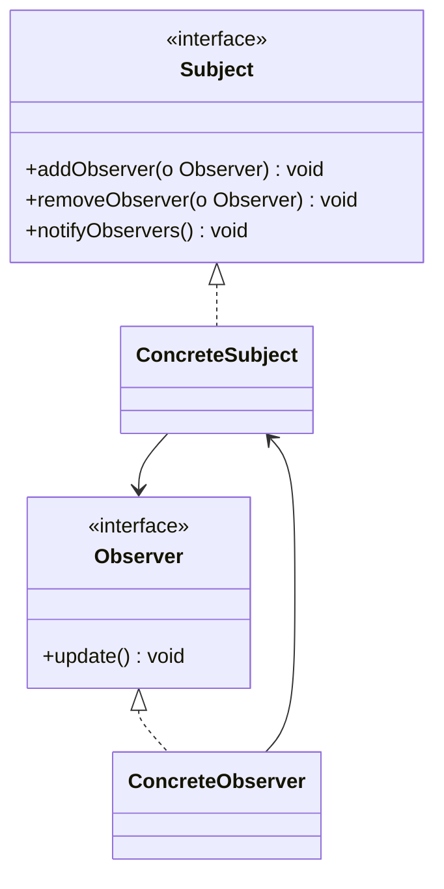

# Observer Pattern

> Defines a one-to-many dependency between objects so that when one object changes state, all its dependents are notified and updated automatically.

## Intent

Observer is a **behavioral** design pattern. It establishes a one-to-many, loosely coupled dependency between a subject and its observers, automatically notifying all observers when the subject's state changes.

## Problem

When one object (the subject) changes state, other objects (observers) need to be notified and updated. Hardcoding dependencies between objects increases coupling and makes the system hard to maintain and extend.

## Solution

Observer defines a one-to-many dependency: the subject maintains a list of observers and notifies them all on state changes. Observers care only about state changes, not the subject's internals.

| Role | Description |
|------|-------------|
| Subject | Maintains the observer list and provides register/remove/notify methods |
| Concrete subject | Holds state and notifies observers on change |
| Observer | Declares the update interface |
| Concrete observer | Implements the update logic |

## Structure

- **Subject**: maintains and notifies the observer list.
- **ConcreteSubject**: holds state and triggers notifications on change.
- **Observer**: declares the update interface.
- **ConcreteObserver**: implements the update logic.

## Effects

**Pros**

- **Loose coupling**: subject and observers evolve independently.
- **Extensibility**: new observers do not affect existing objects.
- **Automatic notification**: reduces manual notification maintenance.
- **Reusability**: subjects and observers can be reused across scenarios.

**Cons**

- **Performance**: too many observers or poor notification can degrade performance.
- **Update order**: observer update order may affect behavior.
- **Overuse risk**: not every state change suits this pattern.

**When to use**

- When objects need state notification with one-to-many, loosely coupled communication.

## Cases in this project

- [Weather Station](weather/README.md) — notifies multiple display panels of weather data changes.
- [Number Observer](numberobserver/README.md) — observes number changes and updates the display.