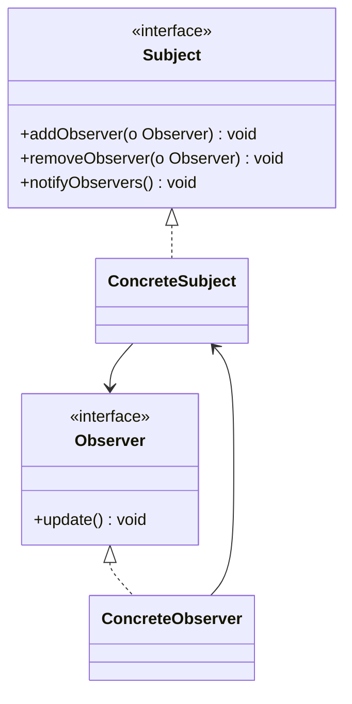

# 观察者模式（Observer）

> 定义对象间的一种一对多的依赖关系，当一个对象的状态发生改变时，所有依赖于它的对象都得到通知并被自动更新。

## 意图

观察者模式（Observer）是一种**行为型**设计模式。它在主题与观察者之间建立一对多的松耦合依赖，主题状态改变时自动通知所有观察者更新。

## 问题

一个对象（主题）状态改变时，其他对象（观察者）需要得到通知并更新。若在对象间硬编码依赖，会导致耦合增加、难以维护和扩展。

## 解决方案

观察者模式定义一对多依赖：主题维护观察者列表，状态改变时自动通知所有观察者。观察者只关心主题状态变化，无需了解其内部实现。

| 角色 | 说明 |
|------|------|
| 主题 | 维护观察者列表，提供注册/移除/通知方法 |
| 具体主题 | 保存状态，状态变化时通知观察者 |
| 观察者 | 声明更新接口 |
| 具体观察者 | 实现更新逻辑，响应主题变化 |

## 结构

- **主题（Subject）**：维护观察者列表并通知。
- **具体主题（ConcreteSubject）**：保存状态，变化时触发通知。
- **观察者（Observer）**：声明更新接口。
- **具体观察者（ConcreteObserver）**：实现更新逻辑。

## 效果

**优点**

- **松耦合**：主题与观察者独立变化。
- **可扩展**：新增观察者不影响已有对象。
- **自动通知**：减少手动维护通知的工作。
- **可复用**：主题与观察者可在不同场景复用。

**缺点**

- **性能问题**：观察者过多或通知不合理时可能性能下降。
- **更新顺序**：观察者更新顺序可能影响行为。
- **过度使用风险**：并非所有状态变化都适合使用。

**适用场景**

- 对象间状态通知与更新，需要一对多松耦合通信的场景。

## 项目中的案例

- [气象站](weather/README_zh.md) —— 用观察者通知多个显示面板更新天气数据。
- [数字观察](numberobserver/README_zh.md) —— 用观察者监听数字变化并更新显示。