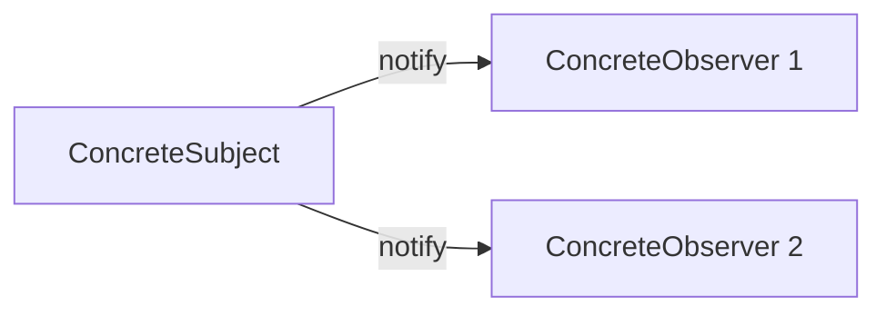
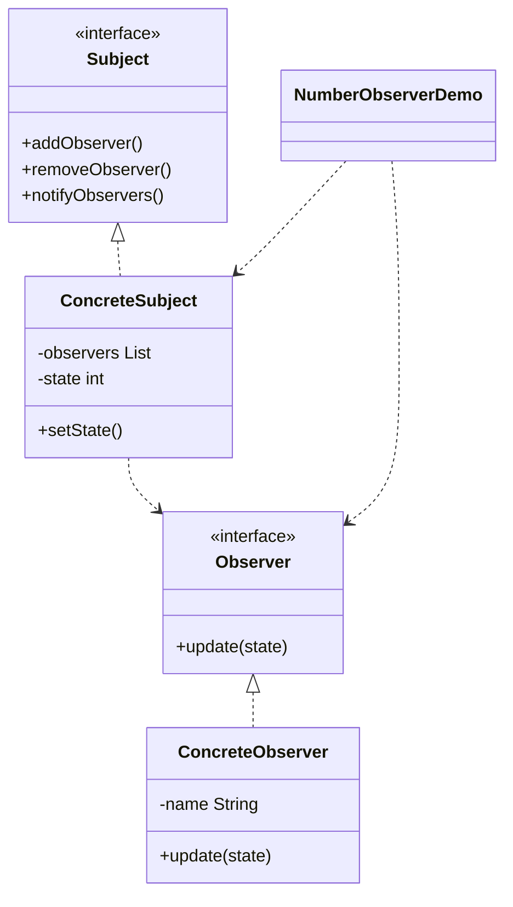

# Number Observer — Observer

> A subject notifies registered observers whenever its number changes, keeping
> them automatically in sync.

## Big Picture

## Scenario

A counter's value changes over time and several displays must reflect the new
value immediately. Observers subscribe to the subject, receive updates on change,
and can unsubscribe at any time.

## Design Pattern

**Observer** — defines a one-to-many dependency so that when one object changes
state, all its dependents are notified automatically.

Why it fits:

- `Subject` is the **subject** interface; `ConcreteSubject` holds the state and
  notifies observers.
- `Observer` is the **observer** interface; `ConcreteObserver` reacts to updates.
- Adding and removing observers at runtime changes who gets notified.

## Structure

| Role | Participants |
|------|--------------|
| Subject | `Subject` |
| Concrete subject | `ConcreteSubject` |
| Observer | `Observer` |
| Concrete observer | `ConcreteObserver` |
| Client / demo | `NumberObserverDemo` |

## Design Rationale

- Observers are loosely coupled to the subject: the subject only knows the
  `Observer` interface.
- `CopyOnWriteArrayList` allows safe iteration while observers are notified.
- Observers can be attached or detached at runtime without affecting the subject.