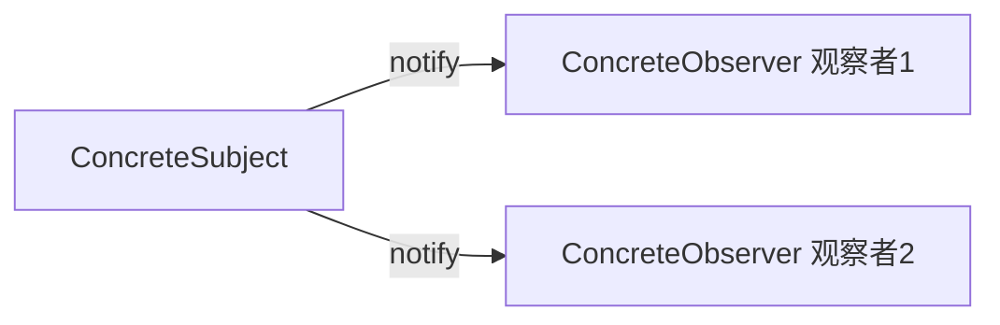
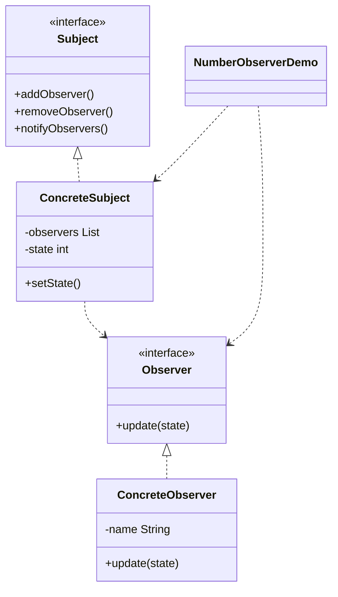

# 数字观察 — 观察者

> 当主题的数字变化时，通知所有已注册的观察者，使其自动保持同步。

## 整体概览

## 场景描述

一个计数器的值不断变化，多个显示面板需要立即反映新值。观察者订阅主题，
在变化时收到更新，也可随时取消订阅。

## 设计模式

**观察者** —— 定义一对多的依赖关系，当一个对象状态改变时，自动通知所有
依赖它的对象。

为什么匹配：

- `Subject` 是**主题**接口；`ConcreteSubject` 持有状态并通知观察者。
- `Observer` 是**观察者**接口；`ConcreteObserver` 对更新作出响应。
- 运行时增删观察者会改变被通知的对象集合。

## 结构

| 角色 | 参与者 |
|------|--------|
| 主题 | `Subject` |
| 具体主题 | `ConcreteSubject` |
| 观察者 | `Observer` |
| 具体观察者 | `ConcreteObserver` |
| 客户端 / 演示 | `NumberObserverDemo` |

## 设计理念

- 观察者与主题松耦合：主题只知道 `Observer` 接口。
- `CopyOnWriteArrayList` 允许在通知观察者时安全迭代。
- 观察者可在运行时挂载或摘除，不影响主题。