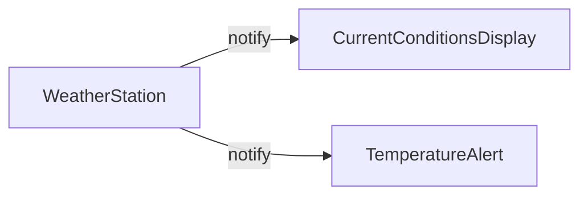
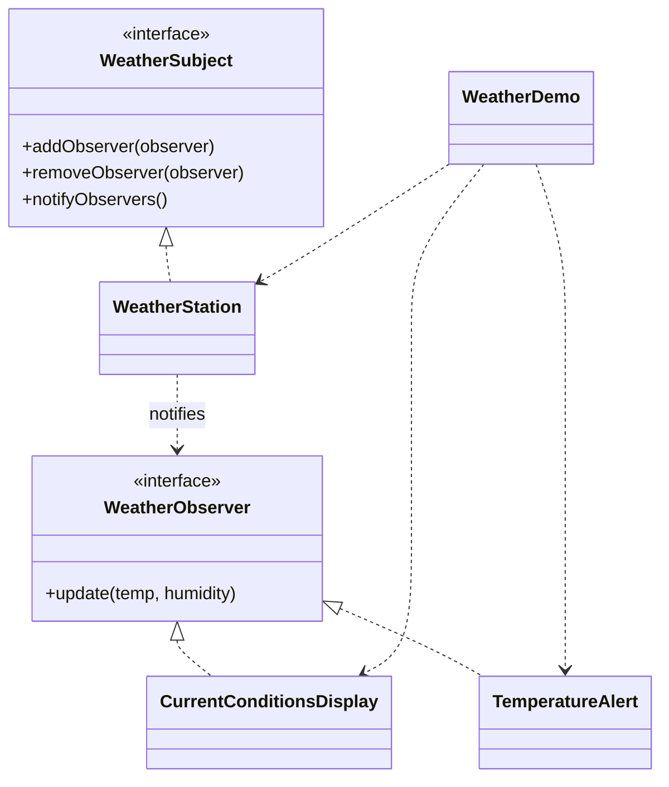

# Weather Station — Observer

> A weather station pushes measurement updates to registered displays, each
> reacting in its own way.

## Big Picture

## Scenario

A weather station measures temperature and humidity. Several consumers want
the data: a display shows current conditions, and an alert only fires when the
temperature crosses a threshold. The station knows nothing about their
internals — it just notifies its observers.

## Design Pattern

**Observer** — defines a one-to-many dependency so that when one object
changes, all dependents are notified.

Why it fits:

- `WeatherSubject` is the subject contract.
- `WeatherStation` maintains observers and notifies on measurement change.
- `CurrentConditionsDisplay` and `TemperatureAlert` react differently to the
  same update.

## Structure

| Role | Participants |
|------|--------------|
| Subject | `WeatherSubject` |
| Concrete subject | `WeatherStation` |
| Observer | `WeatherObserver` |
| Concrete observers | `CurrentConditionsDisplay`, `TemperatureAlert` |
| Client / demo | `WeatherDemo` |

## Design Rationale

- The weather scenario uses push of structured data (temperature + humidity),
  distinct from the "Number Observer" (single int) example.
- Two observers with different reactions show the flexibility of the pattern.
- One file per type, following the Java convention, keeps each role readable.