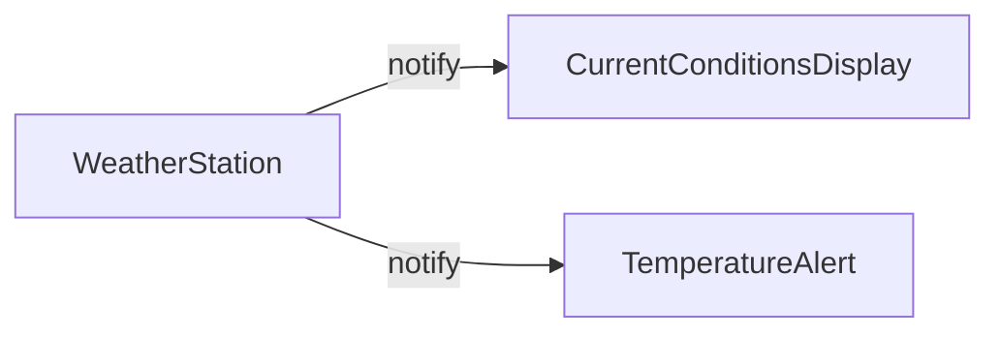
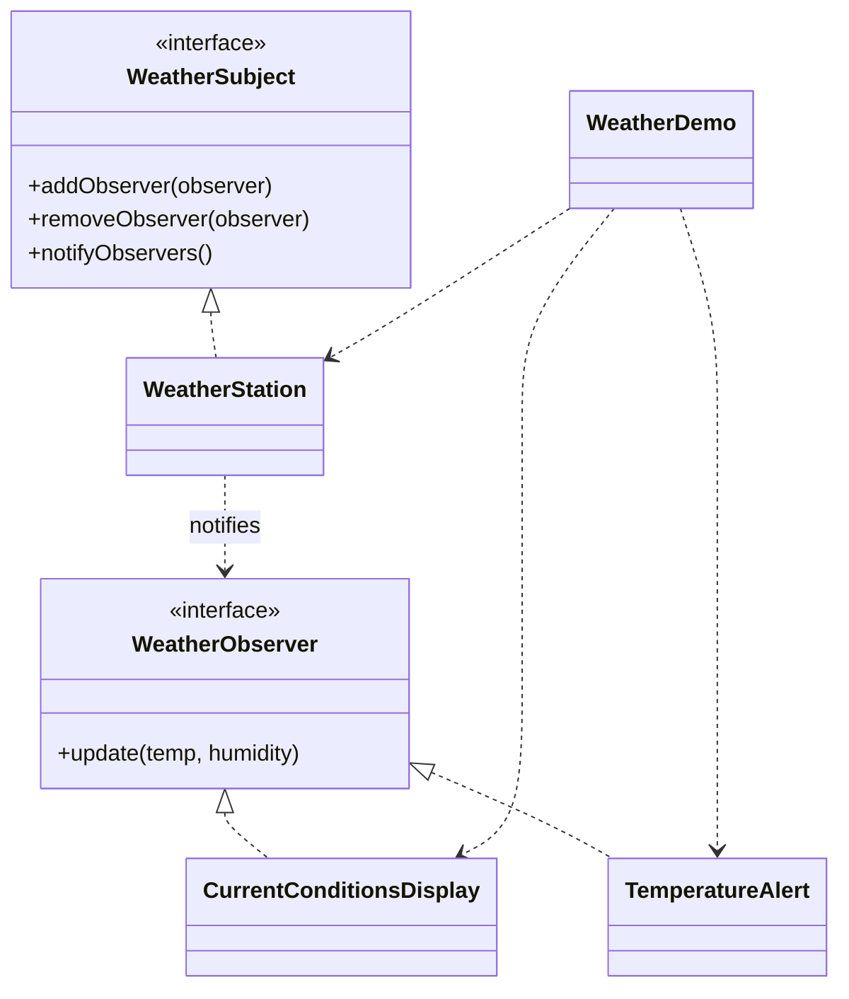

# 气象站 — 观察者

> 气象站把测量更新推送给已注册的显示装置，各自以不同方式响应。

## 整体概览

## 场景描述

气象站测量温度与湿度。多个消费者需要这些数据：一个显示屏展示当前天气，一个预警
装置只在温度超过阈值时触发。气象站完全不了解它们的内部实现——它只是通知自己的
观察者。

## 设计模式

**观察者** —— 定义一对多依赖，当一个对象变化时，所有依赖者都会被通知。

为什么匹配：

- `WeatherSubject` 是主题契约。
- `WeatherStation` 维护观察者并在测量变化时通知。
- `CurrentConditionsDisplay` 与 `TemperatureAlert` 对同一次更新做出不同响应。

## 结构

| 角色 | 参与者 |
|------|--------|
| 主题 | `WeatherSubject` |
| 具体主题 | `WeatherStation` |
| 观察者 | `WeatherObserver` |
| 具体观察者 | `CurrentConditionsDisplay`、`TemperatureAlert` |
| 客户端 / 演示 | `WeatherDemo` |

## 设计理念

- 气象场景推送结构化数据（温度 + 湿度），与"数字观察者"（单个整数）示例明显区分。
- 两个观察者做出不同响应，展示了模式的灵活性。
- 遵循 Java 惯例一个类型一个文件，让每个角色都清晰可读。