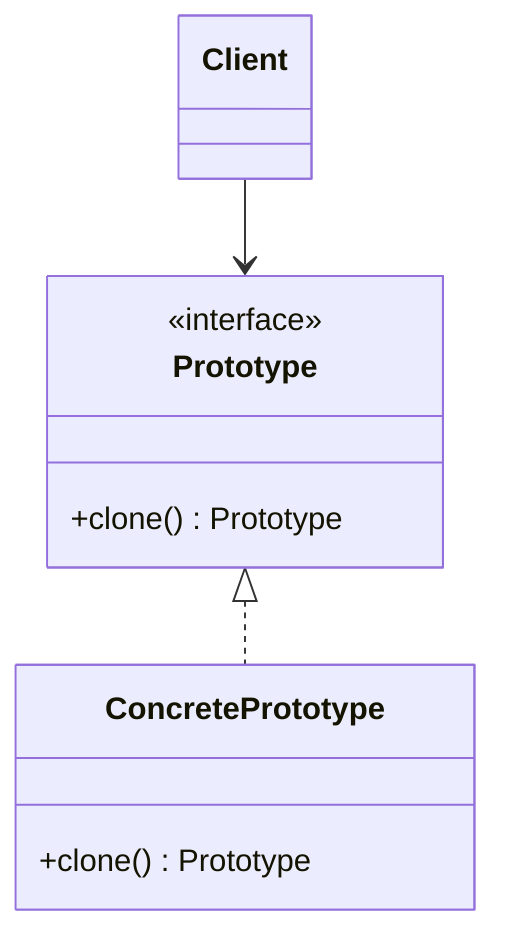

# Prototype Pattern

> Specifies the kinds of objects to create using a prototypical instance, and creates new objects by copying this prototype.

## Intent

Prototype is a **creational** design pattern. It creates new objects by copying an existing one instead of building from scratch, efficiently producing instances that share the prototype's initial state while avoiding coupling to concrete classes.

## Problem

Sometimes you need a copy of an object, but copying it is expensive, or you want to avoid coupling to its concrete class. When creation is complex or an object holds a lot of shared state, conventional creation can degrade performance.

## Solution

Prototype clones from an existing prototype so the new object starts with the same initial state. An abstract prototype declares the clone method, and concrete prototypes implement it to copy themselves.

| Role | Description |
|------|-------------|
| Abstract prototype | Declares the clone method, acting as the base or interface of all concrete prototypes |
| Concrete prototype | Implements the clone method to create a copy of itself |
| Client | Creates new instances by cloning existing objects |

## Structure

- **Prototype**: declares the clone interface.
- **ConcretePrototype**: implements the clone method, returning a copy of itself.
- **Client**: holds a prototype reference and calls `clone()` to obtain new objects.

## Effects

**Pros**

- **Lower creation cost**: avoids repeated initialization of complex objects.
- **No coupling to concrete classes**: clients depend only on the prototype interface.
- **Flexibility**: prototypes can be added or removed at runtime.
- **Dynamic configuration**: objects can be customized by cloning, without code changes.

**Cons**

- **Deep-clone issues**: a default shallow clone copies only the object and its references; deep cloning must be implemented when the object holds references.
- **Clone constraints**: objects involving files, network connections, etc. are hard to clone.

**When to use**

- When you need object copies whose creation is expensive or want to avoid coupling to concrete classes.

## Cases in this project

- [Resume Clone](resumeclone/README.md) — quickly generates multiple resumes from a cloned template.
- [Shape Clone](shapeclone/README.md) — quickly duplicates shape objects by cloning a prototype.