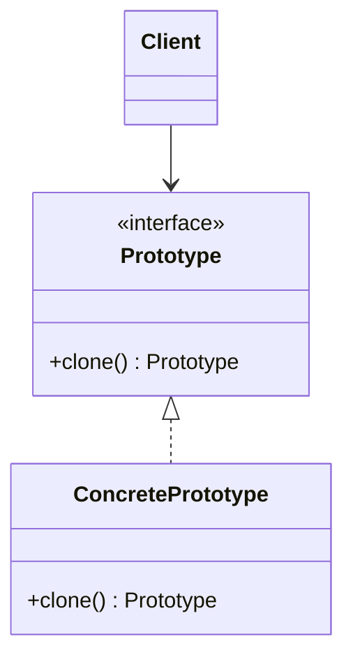

# 原型模式（Prototype）

> 用原型实例指定创建对象的种类，并通过拷贝这些原型创建新的对象。

## 意图

原型模式（Prototype）是一种**创建型**设计模式。它通过复制现有对象来创建新对象，而不是从头构建，从而在避免与具体类耦合的同时，高效地获得与原型状态一致的新实例。

## 问题

有时需要创建对象的副本，但复制一个对象的成本可能很高，或者希望避免与对象的具体类耦合。当创建过程复杂、或对象包含大量共享状态时，用常规方式创建会导致性能下降。

## 解决方案

原型模式在原型对象的基础上进行克隆，让新对象拥有与原对象相同的初始状态。它通过抽象原型声明克隆方法，具体原型实现该方法来复制自身。

| 角色 | 说明 |
|------|------|
| 抽象原型 | 声明克隆方法，作为所有具体原型的基类或接口 |
| 具体原型 | 实现克隆方法，从自身创建副本 |
| 客户端 | 需要新对象时通过克隆现有对象来创建实例 |

## 结构

- **抽象原型（Prototype）**：声明克隆接口。
- **具体原型（ConcretePrototype）**：实现克隆方法，返回自身副本。
- **客户端（Client）**：持有原型引用，通过调用 `clone()` 获取新对象。

## 效果

**优点**

- **降低创建成本**：避免复杂对象的重复初始化，提高创建效率。
- **避免与具体类耦合**：客户端只依赖原型接口即可创建新对象。
- **灵活性**：可在运行时动态增删原型。
- **支持动态配置**：通过克隆定制对象的不同配置，无需修改代码。

**缺点**

- **深克隆问题**：默认浅克隆只复制对象本身与引用，对象内部含引用时需自行实现深克隆。
- **克隆实现受限**：涉及文件、网络连接等资源的对象难以克隆。

**适用场景**

- 需要创建对象副本、且创建成本高或希望避免与具体类耦合的场景。

## 项目中的案例

- [简历克隆](resumeclone/README_zh.md) —— 通过克隆模板快速生成多份简历。
- [图形克隆](shapeclone/README_zh.md) —— 通过克隆原型快速复制图形对象。